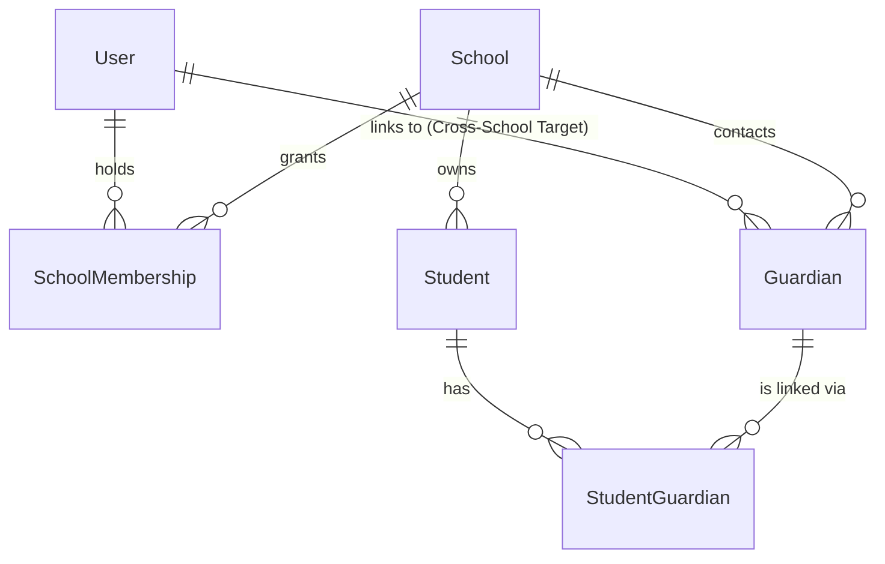

# SyncAcademy — Multi-Tenancy Architecture

## 1. Tenant Model: Shared Database, Shared Schema, Discriminator-Isolated

SyncAcademy uses a **Shared PostgreSQL Database, Shared Schema** multi-tenancy architecture where every school is a distinct tenant represented by a row in the `School` table (`School.id`).

All school-owned domain tables include a mandatory `schoolId` foreign key column with `ON DELETE CASCADE` (or explicit relational scoping via parent entities) and composite database indexes beginning with `schoolId` (e.g., `@@index([schoolId, status])`, `@@unique([schoolId, admissionNumber])`).

---

## 2. Identity vs. Tenant Membership Separation

SyncAcademy separates **Global User Identity** (`User`) from **Tenant Authorization** (`SchoolMembership`):

- A single `User` account (identified by email/phone) can hold multiple `SchoolMembership` records across one or more schools.
- Within a single school, a user can hold multiple roles (for example, both `TEACHER` and `CLASS_TEACHER`).
- Platform operators have `User.isSuperAdmin = true`, granting cross-tenant administrative visibility via `/super-admin`.

---

## 3. Tenant Context Resolution & Enforcement Rules

1. **Explicit Route Scoping**:
   - School-scoped API routes explicitly include `:schoolId` in the URL path (e.g., `/api/schools/:schoolId/academics/*`, `/api/schools/:schoolId/bursar/*`, `/api/schools/:schoolId/registrar/*`).
2. **Mandatory Membership Verification**:
   - On every school-scoped request, the backend must verify that the authenticated session's `viewer` either:
     - Has `viewer.user.isSuperAdmin === true`, OR
     - Has an `ACTIVE` `SchoolMembership` matching `membership.schoolId === schoolId` and `allowedRoles.includes(membership.role)`.
3. **Composite Primary/Foreign Key Lookup Invariant**:
   - Never fetch, update, or delete a tenant resource by `:id` alone. Every query must constrain both `id` and `schoolId` (e.g., `where: { id: recordId, schoolId }`) so that an authenticated user in School A can never read or mutate a record belonging to School B (preventing Insecure Direct Object Reference / IDOR).
4. **Realtime Stream Isolation**:
   - Server-Sent Events (`/api/realtime/stream?schoolId=...`) verify that the authenticated viewer belongs to the requested `schoolId` before subscribing the response stream to `RealtimeBus` events for that tenant.
