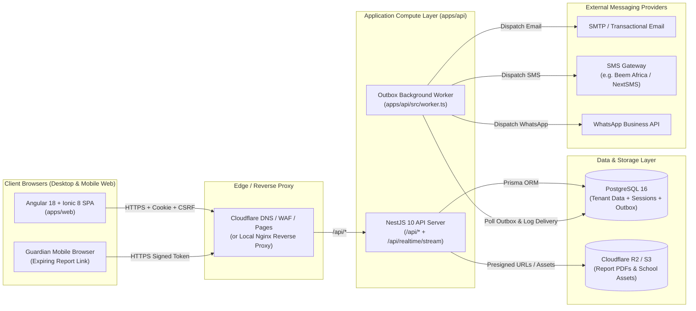

# SyncAcademy — System Architecture

## 1. Architectural Overview

SyncAcademy is architected as a **modular, multi-tenant web platform** built on an npm workspaces monorepo. It deliberately avoids microservice sprawl, message-broker complexity (no Kafka or Redis dependency), and heavyweight infrastructure in favor of three cohesive runtime components backed by a single **PostgreSQL 16** database:

1. **Web Client (`apps/web`)**: An Angular 18 + Ionic 8 single-page application serving role-based portals for Super Admin, School Admin, Headmaster, Academic Master, Registrar, Bursar, and Class/Subject Teachers.
2. **REST & Realtime API Server (`apps/api` — `src/main.ts`)**: A NestJS 10 HTTP server exposing REST endpoints under `/api/*` and a Server-Sent Events (SSE) stream at `/api/realtime/stream`.
3. **Transactional Outbox Worker (`apps/api` — `src/worker.ts`)**: A lightweight Node.js background process that polls the PostgreSQL `Outbox` table using row-level locking (`FOR UPDATE SKIP LOCKED` / atomic claim updates) to dispatch emails, SMS, WhatsApp messages, and asynchronous notifications reliably.

---

## 2. System Topology Diagram

---

## 3. Core Architectural Principles

1. **Database-Backed Simplicity**:
   - Sessions (`UserSession`), asynchronous job queues (`Outbox`), communication logs (`CommunicationLog`), and audit trails (`AuditLog`) all reside in PostgreSQL. This eliminates operational overhead and cost from external Redis or RabbitMQ clusters during the MVP phase.
2. **Strict Multi-Tenant Isolation**:
   - Every school is represented by a `School` record (`id`). Tenant-owned entities carry an explicit `schoolId` foreign key indexed for fast filtering and isolation.
3. **Real-Time Portal Synchronization**:
   - Mutations across school setup, registrar workflows, academic marks/approvals, and bursar fee records publish events through `RealtimeBus` (`apps/api/src/realtime-bus.ts`) over Server-Sent Events (`/api/realtime/stream`) to connected clients belonging to the same school.
4. **Transactional Outbox Reliability**:
   - Domain mutations and notification enqueueing occur inside a single Prisma transaction (`$transaction`). Even if an external SMTP or SMS provider is temporarily unreachable, the domain transaction succeeds and the worker retries delivery with exponential backoff.
