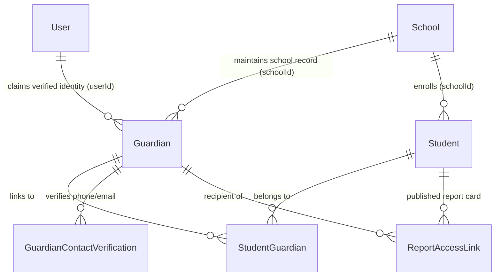
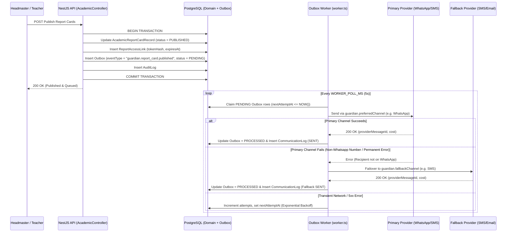

# SyncAcademy — Guardian Identity & Multi-Channel Communication Architecture

> **Status**: Architectural Design Proposal (Phase 1 Deliverable — Ready for Phase 3 Implementation)
> **Scope**: Multi-school Guardian Identity, SMS/WhatsApp/Email Provider Abstraction, PostgreSQL Transactional Outbox Integration, Secure Expiring Report-Access Links, Delivery Tracking, and Cost Governance.

---

## 1. Executive Summary & Design Goals

In Tanzanian primary and secondary schools, parent engagement depends on reaching guardians reliably across **SMS**, **WhatsApp**, and **Email**—even when guardians do not yet have a smartphone app or remembered portal password. Furthermore, a single parent frequently has multiple children enrolled across **different schools** (for example, one child in a primary school and two children in a secondary school that both use SyncAcademy).

This architecture extends SyncAcademy's existing PostgreSQL `Guardian`, `StudentGuardian`, `Outbox`, and `CommunicationLog` models to support:
1. **Cross-School Family Accounts** (`User` <-> multiple school `Guardian` profiles <-> multiple `Student` records across schools).
2. **Pluggable Multi-Channel Provider Abstractions** (`SmsProvider`, `WhatsAppProvider`, `EmailProvider`) with automatic failover and Tanzania E.164 phone normalization (`+255...`).
3. **PostgreSQL-Backed Transactional Outbox** (reusing `Outbox` and `apps/api/src/worker.ts` without introducing Redis or Kafka).
4. **Secure, Expiring Report-Access Links** allowing guardians to view/download published report cards via SMS/WhatsApp/Email links with optional phone-last-4/OTP verification, revocation, and full access auditing.

---

## 2. Guardian Identity & Cross-School Data Model

### 2.1 Current Implementation vs. Target Multi-School Model

Currently in `apps/api/prisma/schema.prisma`:
- `Guardian` is scoped per school (`schoolId`, `fullName`, `phone`, `email`, `relationship`) with `@@index([schoolId, phone])`.
- `StudentGuardian` joins `Student` (`studentId`) and `Guardian` (`guardianId`) with `isPrimary` and `canReceiveNotifications`.

To support **one guardian account linked to multiple children across multiple schools** while preserving school-level autonomy over local guardian directory records:



### 2.2 Proposed Additive Prisma Schema Extensions

```prisma
enum ContactChannel {
  SMS
  WHATSAPP
  EMAIL
}

enum DeliveryStatus {
  QUEUED
  SENT
  DELIVERED
  READ
  FAILED
  UNDELIVERABLE
}

// Additive fields on existing Guardian model:
// model Guardian {
//   ...existing fields...
//   userId               String?   // Links to global User account for cross-school Parent Portal login
//   phoneE164            String?   // Normalized E.164 phone (e.g. "+255712345678")
//   whatsappPhoneE164    String?   // Optional distinct WhatsApp number in E.164
//   phoneVerifiedAt      DateTime?
//   whatsappVerifiedAt   DateTime?
//   emailVerifiedAt      DateTime?
//   preferredChannel     ContactChannel @default(SMS)
//   fallbackChannel      ContactChannel? @default(EMAIL)
//   preferredLanguage    String    @default("sw") // "sw" (Kiswahili) or "en" (English)
//   optOutSms            Boolean   @default(false)
//   optOutWhatsapp       Boolean   @default(false)
//   optOutEmail          Boolean   @default(false)
//   user                 User?     @relation(fields: [userId], references: [id], onDelete: SetNull)
//   @@index([phoneE164])
//   @@index([userId])
// }
```

### 2.3 Multiple Guardian-Student & Cross-School Resolution Rules
1. **Multiple Guardians per Student**: A `Student` can have multiple `StudentGuardian` rows (e.g., Father as `isPrimary = true`, Mother as `isPrimary = false, canReceiveNotifications = true`, and a Sponsor/Relative with `canReceiveNotifications = false` or fee-only notifications).
2. **Multiple Students per Guardian (Same School)**: Within one school, a single `Guardian` row links to multiple sibling `Student` rows via `StudentGuardian`.
3. **Multiple Students Across Different Schools (Cross-School Family Account)**:
   - School A and School B each maintain their own tenant-scoped `Guardian` row so School A's registrar cannot edit School B's contact notes.
   - Both `Guardian` rows share the same verified `phoneE164` (and/or `email`) and link to the same global `User.id` (`Guardian.userId`).
   - When the parent logs into the Parent Portal as `User`, the backend queries `Guardian.findMany({ where: { userId: viewer.user.id } })` and aggregates children across both School A and School B into one unified family switcher while enforcing per-school tenant permissions on every child query.

---

## 3. Contact Verification & Communication Preferences

1. **E.164 Phone Normalization**:
   - Tanzanian local numbers (`07XXXXXXXX`, `06XXXXXXXX`, `2557XXXXXXXX`) are normalized on write to strict E.164 format (`+2557XXXXXXXX`) via a shared utility before persistence.
2. **Contact Verification Flow**:
   - When a registrar records or updates a guardian's phone/email, or when a guardian claims a cross-school account, the system can issue a 6-digit verification code (hashed with SHA-256, 10-minute TTL, max 5 attempts) via SMS/WhatsApp/Email.
   - Upon verification, `phoneVerifiedAt` / `emailVerifiedAt` is stamped and matching `Guardian` rows across schools with the same verified `phoneE164` can be linked to the guardian's global `User` account.
3. **Preference & Opt-Out Resolution**:
   - Each guardian specifies `preferredChannel` (`SMS`, `WHATSAPP`, `EMAIL`), `fallbackChannel`, and `preferredLanguage` (`sw` for Kiswahili or `en` for English).
   - Guardians receiving automated notifications must have `StudentGuardian.canReceiveNotifications = true` and must not have opted out of the target channel.

---

## 4. Provider Abstraction Architecture (SMS, WhatsApp, Email)

All external communication providers implement a unified TypeScript contract under `apps/api/src/communication/` so providers can be swapped per environment or per school via configuration without changing domain or worker code.

### 4.1 Core Provider Interfaces

```typescript
export interface OutboundMessageRequest {
  schoolId: string;
  outboxId: string;
  idempotencyKey: string;
  recipient: string; // E.164 phone or email address
  templateKey?: string;
  language?: 'sw' | 'en';
  subject?: string;
  textBody: string;
  htmlBody?: string;
  metadata?: Record<string, unknown>;
}

export interface OutboundMessageResult {
  providerName: string;       // e.g. 'beem-sms', 'meta-whatsapp', 'smtp-nodemailer', 'mock'
  providerMessageId: string;
  status: 'SENT' | 'DELIVERED' | 'FAILED';
  unitCostTzs?: number;       // Estimated cost in Tanzanian Shillings (TZS)
  segments?: number;          // SMS segment count (160 GSM-7 / 70 UCS-2 chars)
  rawResponseSummary?: string;
  errorCode?: string;
  isRetryable?: boolean;
}

export interface CommunicationChannelProvider {
  readonly channel: 'SMS' | 'WHATSAPP' | 'EMAIL';
  readonly providerName: string;
  send(request: OutboundMessageRequest): Promise<OutboundMessageResult>;
}
```

### 4.2 Channel-Specific Adapters & Cost-Conscious Provider Choices

1. **SMS Provider Abstraction (`SmsProvider`)**:
   - **Recommended Tanzanian Gateways**: **Beem Africa** or **NextSMS** (local Tanzanian aggregator pricing in TZS, direct MNO routes to Vodacom, Airtel, Tigo/Mixx by Yas, Halotel, and support for custom Sender IDs such as `SYNCACADEMY`).
   - **Adapters**: `BeemSmsProvider`, `NextSmsProvider`, `TwilioSmsProvider`, and `ConsoleMockSmsProvider` (for local development/tests).
   - **Character & Segment Guardrails**: Templates enforce GSM-7 encoding (`<= 160` characters for 1 segment or `<= 306` characters for 2 segments) to prevent accidental 3–4 segment billing spikes.
2. **WhatsApp Provider Abstraction (`WhatsAppProvider`)**:
   - **Recommended Gateway**: **Meta WhatsApp Cloud API** (direct, zero markup per conversation beyond Meta utility template rates) or Beem/Twilio WhatsApp API.
   - **Template Compliance**: Uses pre-approved Meta Utility Templates (`report_card_published_v1`, `fee_payment_receipt_v1`, `attendance_absence_alert_v1`) with localized parameter interpolation (`sw` / `en`).
3. **Email Provider Abstraction (`EmailProvider`)**:
   - **Current Implementation**: Nodemailer SMTP (`apps/api/src/worker.ts` + `apps/api/src/communication/email/email-templates.ts`) reading encrypted SMTP settings from `PlatformSetting` or environment variables.
   - **Production Evolution**: Supports SMTP or HTTP API providers (Cloudflare Email Routing + Resend / AWS SES / Postmark) behind the same `EmailProvider` interface.

---

## 5. Transactional Outbox Integration, Retries & Provider Failover

SyncAcademy **reuses the existing PostgreSQL `Outbox` and `CommunicationLog` tables** rather than adding Redis or Kafka.



### 5.1 Retry Policy & Dead-Letter Handling
- **Max Attempts**: `MAX_OUTBOX_ATTEMPTS = 5`.
- **Exponential Backoff with Jitter**:
  - Attempt 1: immediate
  - Attempt 2: `+30 seconds`
  - Attempt 3: `+2 minutes`
  - Attempt 4: `+10 minutes`
  - Attempt 5: `+1 hour`
- **Channel Failover**:
  - If a message fails on `WHATSAPP` with a permanent channel error (e.g., number not registered on WhatsApp) or exceeds 2 transient failures, the worker automatically falls back to `SMS` (if `phoneE164` is available and not opted out) or `EMAIL`, logging both attempts in `CommunicationLog`.
- **Dead-Letter State**:
  - After 5 failed attempts across primary and fallback channels, `Outbox.status` transitions to `FAILED` with `lastError` populated, surfacing an alert in the School Admin / Super Admin communication monitor for manual contact correction.

---

## 6. Message Templates & Localization (`sw` / `en`)

Templates are versioned in code (`apps/api/src/communication/templates/`) with strict variable schemas validated by Zod:

| Template Key | Trigger Event | Channels | Example Kiswahili (`sw`) SMS Body (<= 160 chars) |
|---|---|---|---|
| `guardian.report_card.published` | Headmaster publishes term report cards | SMS, WhatsApp, Email | `Shule ya {{schoolShortName}}: Matokeo ya {{studentFirstName}} ({{termName}}) yapo tayari. Fungua: {{shortLink}} (Inaisha {{expiryDate}})` |
| `guardian.attendance.absent` | Student marked `ABSENT` without excuse | SMS, WhatsApp | `Taarifa kutoka {{schoolShortName}}: {{studentFirstName}} hajafika shuleni leo {{date}}. Wasiliana na shule kwa maelezo zaidi.` |
| `guardian.bursar.payment_received` | Bursar records fee payment | SMS, WhatsApp, Email | `{{schoolShortName}}: Tumepokea TZS {{amount}} kwa ada ya {{studentFirstName}} (Risiti {{receiptNo}}). Salio: TZS {{balance}}.` |
| `staff.invitation.created` | Super Admin / School Admin invites staff | Email, SMS | Existing branded HTML email (`email-templates.ts`) + optional SMS link notification. |

---

## 7. Secure, Expiring Report-Access Links

To allow guardians to view and download a child's official term report card directly from an SMS, WhatsApp message, or Email **without requiring pre-existing portal credentials**, SyncAcademy uses cryptographically random, single-scope expiring links.

### 7.1 `ReportAccessLink` Data Model

```prisma
model ReportAccessLink {
  id                  String    @id @default(cuid())
  schoolId            String
  reportCardId        String    // References AcademicReportCardRecord.id
  studentId           String
  guardianId          String
  tokenHash           String    @unique // SHA-256 hash of 256-bit random URL token
  expiresAt           DateTime  // Default: +14 days from publication
  revokedAt           DateTime?
  revokedByUserId     String?
  revokeReason        String?
  maxAccessCount      Int       @default(25)
  accessCount         Int       @default(0)
  lastAccessedAt      DateTime?
  requirePhoneLast4   Boolean   @default(true)
  createdAt           DateTime  @default(now())

  @@index([schoolId, studentId])
  @@index([reportCardId])
  @@index([expiresAt])
}
```

### 7.2 Security & Verification Mechanics
1. **High-Entropy Unguessable Token**:
   - When a report card is published, the backend generates a 32-byte (`256-bit`) cryptographically random base64url token (`rawToken`) and stores **only** `sha256(rawToken)` in `ReportAccessLink.tokenHash`.
   - The URL sent to the guardian is `https://<app-domain>/r/<rawToken>`.
2. **Lightweight Guardian Challenge (Defense-in-Depth)**:
   - When a guardian opens `/r/<rawToken>`, the public verification endpoint (`POST /api/public/report-links/:token/verify`) checks:
     - Token exists, `revokedAt IS NULL`, `expiresAt > NOW()`, and `accessCount < maxAccessCount`.
     - If `requirePhoneLast4 = true`, the guardian enters the **last 4 digits of their registered phone number** (or Student Admission Number) before the report card payload/PDF is rendered. Rate-limited to 5 attempts per 15 minutes per IP/token.
3. **Instant Link Revocation**:
   - A Headmaster, School Admin, or Registrar can revoke any active report link immediately (`POST /api/schools/:schoolId/academics/report-links/:linkId/revoke`), or the system automatically revokes prior links if a report card is un-published or re-issued.
4. **Comprehensive Audit Logging**:
   - Every link creation, verification failure, successful view/download, and revocation writes an immutable `AuditLog` entry (`report_link.created`, `report_link.accessed`, `report_link.verify_failed`, `report_link.revoked`) recording `ipAddress`, `userAgent`, `schoolId`, `studentId`, and `guardianId`.

---

## 8. Cost Tracking & School Quota Governance

Because SMS and WhatsApp utility messages incur per-message telecom charges in Tanzania (typically ~15–28 TZS per SMS segment), the communication architecture includes built-in cost controls:
1. **Per-Message Cost Recording**: `CommunicationLog` stores `channel`, `segments`, `unitCostTzs`, and `providerName` for every dispatched message.
2. **School Monthly Quota & Budget Caps**: Each `School` tenant can be assigned a monthly SMS/WhatsApp credit quota managed by Super Admin. Non-critical broadcasts pause automatically when a school's quota is exhausted, while critical security/transactional emails continue uninterrupted.
3. **Deduplication Window**: Outbox enqueueing computes an `idempotencyKey` (`sha256(schoolId + guardianId + templateKey + targetEntityId)`) to prevent duplicate SMS charges if a staff member clicks "Publish & Notify" multiple times.
