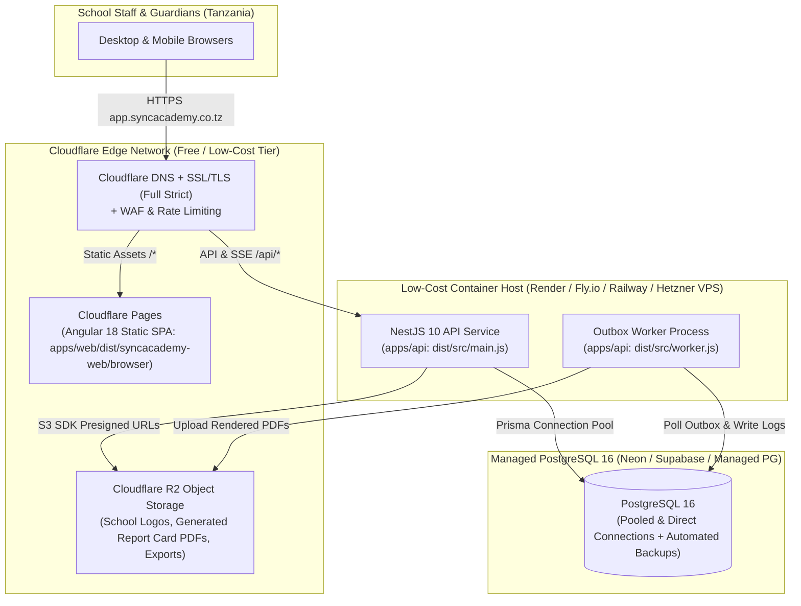

# SyncAcademy — Cloudflare-First & Low-Cost Production Deployment Architecture

## 1. Current Repository Deployment State vs. Target Production Architecture

### 1.1 Current Local / Container Reference Setup
In the repository today, local and single-host containerized deployment is configured via:
- `docker-compose.yml` — Runs 4 containers:
  1. `db` (`postgres:16-alpine`)
  2. `api` (`apps/api/Dockerfile` running `npx prisma migrate deploy && node dist/src/main.js`)
  3. `worker` (`apps/api/Dockerfile` running `node dist/src/worker.js`)
  4. `web` (`apps/web/Dockerfile` building the Angular SPA and serving it via Nginx with `infrastructure/nginx.conf` proxying `/api/` to `http://api:3000`)
- `.github/workflows/ci.yml` — Runs PostgreSQL 16 service container, `prisma:generate`, API tests, API build, and Web build on pushes and pull requests.

### 1.2 Target Cloudflare-First Low-Cost Production Architecture
To minimize monthly hosting expenditure during Tanzanian school pilots while achieving global edge caching, DDoS/WAF protection, and high availability, SyncAcademy uses a **hybrid Cloudflare Edge + Containerized NestJS + Managed PostgreSQL** topology:

---

## 2. Why NestJS Runs in a Container Instead of Cloudflare Workers

While static assets (`apps/web`) and object storage (`R2`) are 100% Cloudflare-native, the NestJS 10 backend (`apps/api`) intentionally runs on a standard Node.js container runtime rather than Cloudflare Workers V8 isolates because:
1. **Native Node.js & C++ Dependencies**: `apps/api` relies on `@nestjs/platform-express`, `argon2` (native password hashing), `nodemailer` (raw TCP SMTP sockets), and standard `@prisma/client` query engines.
2. **Long-Lived Server-Sent Events (SSE)**: `/api/realtime/stream` maintains open HTTP streams per active school tab (`RealtimeController`), which fits stateful Node.js containers naturally without incurring per-duration serverless billing.
3. **Background Outbox Polling (`worker.ts`)**: Running the API and background worker in lightweight Node.js containers behind Cloudflare's proxied DNS (`orange cloud`) gives full Cloudflare TLS, WAF, and DDoS protection at a predictable ~$5–$12/month compute cost.

---

## 3. Component-by-Component Production Specification

### 3.1 Frontend Hosting — Cloudflare Pages
- **Build Command**: `npm ci --ignore-scripts && npm run build --workspace=apps/web`
- **Build Output Directory**: `apps/web/dist/syncacademy-web/browser`
- **Node.js Version**: `22.x`
- **SPA Routing Fallback**: Configure `_redirects` (`/* /index.html 200`) so deep links (`/registrar`, `/academic`, `/r/:token`) resolve cleanly to Angular's router.
- **API Routing**: Route `/api/*` via Cloudflare Pages Functions proxy or same-site subdomain (`api.syncacademy.co.tz` with `SameSite=Lax` cookie domain `.syncacademy.co.tz`) so `syncacademy_session` cookies and SSE streams work seamlessly without third-party cookie blocking.

### 3.2 Object Storage — Cloudflare R2
- **Purpose**: Store school emblems/logos, generated student report card PDFs, certificate PDFs, and bulk data exports.
- **Integration**: Cloudflare R2 is S3-API compatible (`https://<account_id>.r2.cloudflarestorage.com`) with **zero egress fees**, making it ideal when hundreds of guardians download term report cards simultaneously.
- **Access Pattern**: Private R2 bucket; `apps/api` generates short-lived presigned `GET`/`PUT` URLs after verifying tenant (`schoolId`) or `ReportAccessLink` authorization.

### 3.3 Database — Managed PostgreSQL 16
- **Recommended Providers**: Neon Serverless Postgres, Supabase Postgres, DigitalOcean Managed PostgreSQL, or Render Postgres (PostgreSQL 16).
- **Connection Strategy**:
  - `DATABASE_URL`: Pooled connection string (PgBouncer / connection pooler) for runtime queries.
  - `DIRECT_URL` (optional): Direct connection string for `npx prisma migrate deploy` during CI/CD releases.
- **Backups & Point-in-Time Recovery (PITR)**:
  - Daily automated snapshots retained for at least 14 days, plus logical `pg_dump` backups stored encrypted in a dedicated private Cloudflare R2 backup bucket before every major term examination window.

---

## 4. Production Environment Variables Matrix

Never commit production values to Git. Configure these variables in your container platform secret store:

| Variable | Required | Production Value / Requirement |
|---|---|---|
| `NODE_ENV` | Yes | `production` |
| `PORT` | Yes | `3000` |
| `APP_ORIGIN` | Yes | `https://app.syncacademy.co.tz` (exact HTTPS origin) |
| `DATABASE_URL` | Yes | `postgresql://<user>:<pass>@<host>:5432/<db>?sslmode=require` |
| `SESSION_SECRET` | Yes | Cryptographically random 64-char hex string (`openssl rand -hex 32`) |
| `DATA_ENCRYPTION_KEY` | Yes | Cryptographically random 64-char hex string (`openssl rand -hex 32`) |
| `COOKIE_SECURE` | Yes | `true` (enforces HTTPS-only session cookies) |
| `SESSION_COOKIE_NAME` | No | `syncacademy_session` |
| `SESSION_TTL_HOURS` | No | `168` (7 days) |
| `SMTP_HOST` | Yes | Transactional email SMTP host |
| `SMTP_PORT` | Yes | `587` (STARTTLS) or `465` (TLS) |
| `SMTP_SECURE` | No | `false` (for 587 STARTTLS) or `true` (for 465) |
| `SMTP_USER` | Yes | Transactional email username |
| `SMTP_PASS` | Yes | Transactional email password / API key |
| `MAIL_FROM` | Yes | `no-reply@syncacademy.co.tz` |
| `CONTACT_NOTIFICATION_EMAIL` | No | `support@syncacademy.co.tz` |
| `WORKER_POLL_MS` | No | `5000` |

---

## 5. Production Release & Rollback Runbook

1. **Pre-Deploy Verification (GitHub Actions `.github/workflows/ci.yml`)**:
   - Runs `prisma:generate`, backend unit + integration tests against PostgreSQL 16, `npm run build --workspace=apps/api`, and `npm run build --workspace=apps/web`.
2. **Database Migration Step**:
   - Run `npx prisma migrate deploy --schema apps/api/prisma/schema.prisma` as a pre-deploy release command before starting new API/worker containers.
3. **Zero-Downtime Rolling Restart**:
   - Health check endpoint: `GET /api/health` (verifies database connectivity before shifting traffic).
4. **Rollback Procedure**:
   - Revert container image tag and Cloudflare Pages deployment to the previous green commit SHA. Because all Prisma migrations must be additive and backward-compatible (per `AGENTS.md`), application rollbacks do not require destructive database downgrades.
