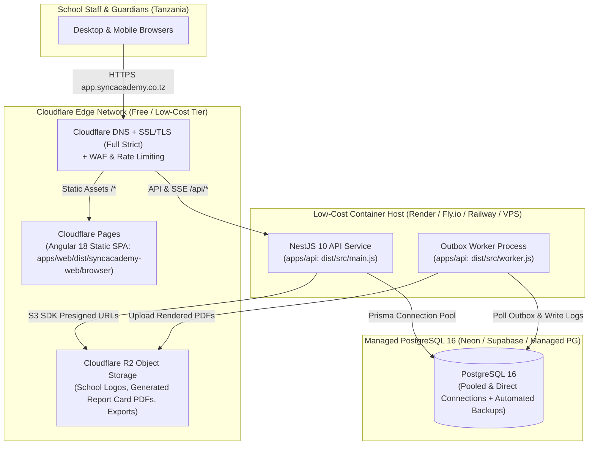

# SyncAcademy — Development, Testing & Cloud Deployment Guide

This document covers local development setup, automated testing standards, and the Cloudflare-first low-cost production deployment architecture for SyncAcademy.

---

## 1. Local Development Setup

### 1.1 Prerequisites
- **Node.js**: `>= 20.x` (Node `22.x` recommended, matches CI)
- **npm**: `>= 10.x` (npm workspaces monorepo)
- **PostgreSQL**: `16.x` (via Docker Compose or local PostgreSQL instance)

### 1.2 Bootstrap & Run Locally
```bash
# 1. Install workspace dependencies
npm ci

# 2. Generate local .env with random 32-byte SESSION_SECRET and DATA_ENCRYPTION_KEY
node scripts/setup-local.mjs

# 3. Start PostgreSQL 16 (port 55432) and apply Prisma migrations
docker compose up -d db
npm run prisma:generate --workspace=apps/api
npm run prisma:migrate:deploy --workspace=apps/api
npm run prisma:seed --workspace=apps/api

# 4. Start API (:3000), Outbox Worker, and Angular Web App (:4200)
npm run dev:api
npm run dev:worker
npm run dev:web
```
Alternatively, start the entire containerized stack (`db`, `api`, `worker`, `web` via Nginx on `http://localhost:8080`):
```bash
npm run docker:up
```

*(Never commit `.env` or `.runtime/` to version control.)*

---

## 2. Automated Testing & Verification Standards

Every change must pass build and test verification before commit:

### 2.1 Build Verification
```bash
npm run prisma:generate --workspace=apps/api
npm run build --workspace=apps/api
npm run build --workspace=apps/web
```

### 2.2 Backend Unit & Integration Tests (`apps/api/test/`)
```bash
# In-memory unit tests (no PostgreSQL required)
node --test apps/api/test/email-templates.test.cjs apps/api/test/platform-settings.test.cjs

# Full database integration suite (requires PostgreSQL running on DATABASE_URL)
npm test --workspace=apps/api
```

### 2.3 Frontend Portal Workflow Verification Scripts (`apps/web/scripts/`)
```bash
npm run test:registrar-workflow --workspace=apps/web
npm run test:academic-workflow --workspace=apps/web
npm run test:academic-years --workspace=apps/web
npm run test:bursar-workflow --workspace=apps/web
npm run test:head-oversight --workspace=apps/web
npm run test:class-teacher --workspace=apps/web
npm run test:school-setup --workspace=apps/web
npm run test:super-admin --workspace=apps/web

# Additional state & concurrency checks
node apps/web/scripts/check-concurrent-drafts.mjs
node apps/web/scripts/check-school-sync.mjs
node apps/web/scripts/check-student-result-summary.mjs
node apps/web/scripts/check-teaching-responsibilities.mjs
```

---

## 3. Cloudflare-First & Low-Cost Production Deployment Architecture

To keep monthly hosting costs ultra-low during Tanzanian school pilots while providing edge caching, WAF/DDoS protection, and zero-egress object storage, SyncAcademy uses a **hybrid Cloudflare Edge + Containerized NestJS + Managed PostgreSQL 16** architecture:



### 3.1 Why NestJS Runs in a Container Instead of Cloudflare Workers
While `apps/web` (Cloudflare Pages) and file storage (Cloudflare R2) are 100% Cloudflare-native, `apps/api` runs in a standard Node.js container behind Cloudflare's proxied DNS (`orange cloud`) because it uses `@nestjs/platform-express`, native `argon2` password hashing, TCP SMTP sockets (`nodemailer`), long-lived Server-Sent Events (`/api/realtime/stream`), and background `Outbox` polling (`worker.ts`).

### 3.2 Production Component Specifications
- **Frontend (Cloudflare Pages)**:
  - Build command: `npm ci --ignore-scripts && npm run build --workspace=apps/web`
  - Output directory: `apps/web/dist/syncacademy-web/browser`
  - SPA fallback rule (`_redirects`): `/* /index.html 200`
- **Object Storage (Cloudflare R2)**:
  - S3-compatible private bucket with zero egress fees for school logos, generated report card PDFs, and certificates, accessed via short-lived presigned URLs generated by `apps/api`.
- **Database (Managed PostgreSQL 16)**:
  - Daily automated snapshots (14-day retention) plus pre-term logical `pg_dump` backups encrypted in a private R2 bucket.

---

## 4. Production Environment Variables Matrix

Configure these variables in the production secret manager (never commit to Git):

| Variable | Required | Production Value / Requirement |
|---|---|---|
| `NODE_ENV` | Yes | `production` |
| `PORT` | Yes | `3000` |
| `APP_ORIGIN` | Yes | `https://app.syncacademy.co.tz` |
| `DATABASE_URL` | Yes | `postgresql://<user>:<pass>@<host>:5432/<db>?sslmode=require` |
| `SESSION_SECRET` | Yes | Random 64-char hex string (`openssl rand -hex 32`) |
| `DATA_ENCRYPTION_KEY` | Yes | Random 64-char hex string (`openssl rand -hex 32`) |
| `COOKIE_SECURE` | Yes | `true` |
| `SESSION_COOKIE_NAME` | No | `syncacademy_session` |
| `SESSION_TTL_HOURS` | No | `168` |
| `SMTP_HOST` | Yes | Transactional email SMTP host |
| `SMTP_PORT` | Yes | `587` or `465` |
| `SMTP_SECURE` | No | `false` (587 STARTTLS) or `true` (465 TLS) |
| `SMTP_USER` | Yes | Transactional email username |
| `SMTP_PASS` | Yes | Transactional email password / API key |
| `MAIL_FROM` | Yes | `no-reply@syncacademy.co.tz` |
| `CONTACT_NOTIFICATION_EMAIL` | No | `support@syncacademy.co.tz` |
| `WORKER_POLL_MS` | No | `5000` |

---

## 5. Release & Rollback Procedure

1. **CI Gate (`.github/workflows/ci.yml`)**: Runs PostgreSQL 16 service container, `prisma:generate`, API tests, API build, and Web build.
2. **Migration Step**: Run `npx prisma migrate deploy --schema apps/api/prisma/schema.prisma` before rolling out new API/worker containers.
3. **Health Check**: Verify `GET /api/health` returns `200 OK` before shifting traffic.
4. **Rollback**: Revert container image tag and Cloudflare Pages deployment to the previous green commit SHA.
