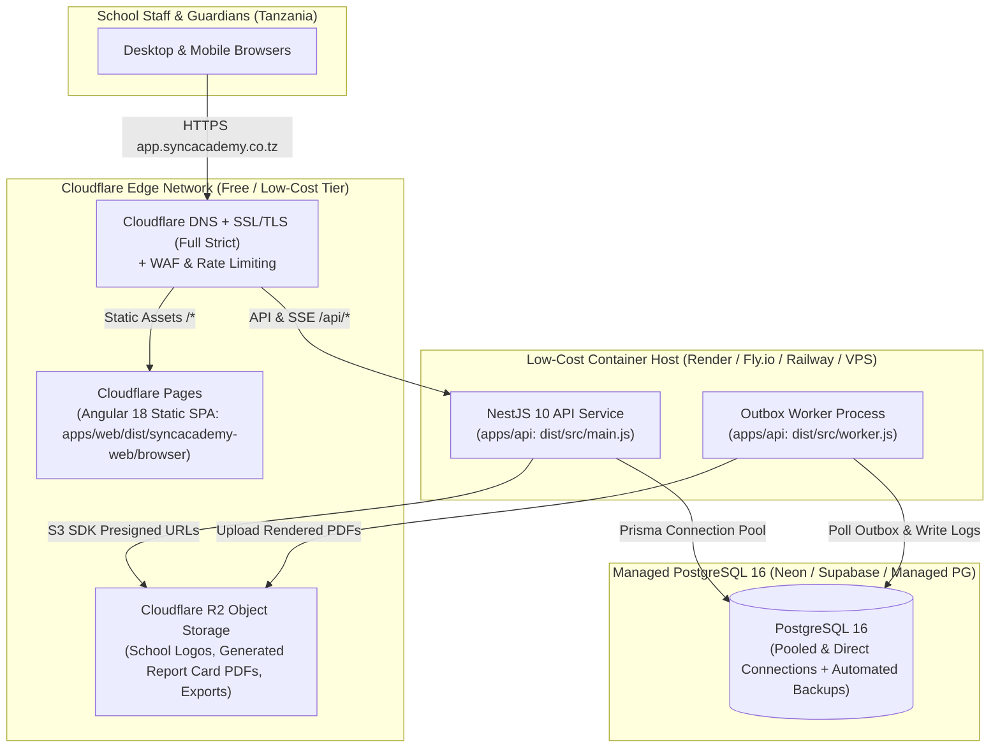

# SyncAcademy — Development, Testing & Cloud Deployment Guide

This document covers local development setup, automated testing standards, and the Cloudflare-first low-cost production deployment architecture for SyncAcademy.

The parent mobile backend runs in the existing API and worker containers. Its additive migration, Flutter API contract, invitation processing, and scaling checks are described in [Parent mobile backend](parent-mobile-backend.md). Use mock communication dispatch and a disposable test database for parent invitation and load tests; production providers must never be exercised by test fixtures.

---

## 1. Local Development Setup

### 1.1 Prerequisites
- **Node.js**: `>= 20.x` (Node `22.x` recommended, matches CI)
- **npm**: `>= 10.x` (npm workspaces monorepo)
- **PostgreSQL**: `16.x` (via Docker Compose or local PostgreSQL instance)

### 1.2 Bootstrap & Run Locally
```bash
# 1. Install workspace dependencies
npm ci

# 2. Generate local .env with random 32-byte SESSION_SECRET and DATA_ENCRYPTION_KEY
node scripts/setup-local.mjs

# 3. Start PostgreSQL 16 (port 55432) and apply Prisma migrations
docker compose up -d db
npm run prisma:generate --workspace=apps/api
npm run prisma:migrate:deploy --workspace=apps/api
npm run prisma:seed --workspace=apps/api

# 4. Start API (:3000), Outbox Worker, and Angular Web App (:4200)
npm run dev:api
npm run dev:worker
npm run dev:web
```
Alternatively, start the entire containerized stack (`db`, `api`, `worker`, `web` via Nginx on `http://localhost:8080`):
```bash
npm run docker:up
```

*(Never commit `.env` or `.runtime/` to version control.)*

---

## 2. Automated Testing & Verification Standards

Every change must pass build and test verification before commit:

### 2.1 Build Verification
```bash
npm run prisma:generate --workspace=apps/api
npm run build --workspace=apps/api
npm run build --workspace=apps/web
```

### 2.2 Backend Unit & Integration Tests (`apps/api/test/`)
```bash
# In-memory unit tests (no PostgreSQL required)
node --test apps/api/test/email-templates.test.cjs apps/api/test/platform-settings.test.cjs
npm run test:audit-log --workspace=apps/api
npm run test:security-hardening --workspace=apps/api

# Full database integration suite (requires PostgreSQL running on DATABASE_URL)
npm test --workspace=apps/api
```

### 2.3 Frontend Portal Workflow Verification Scripts (`apps/web/scripts/`)
```bash
npm run test:registrar-workflow --workspace=apps/web
npm run test:academic-workflow --workspace=apps/web
npm run test:academic-years --workspace=apps/web
npm run test:bursar-workflow --workspace=apps/web
npm run test:head-oversight --workspace=apps/web
npm run test:class-teacher --workspace=apps/web
npm run test:school-setup --workspace=apps/web
npm run test:super-admin --workspace=apps/web

# Additional state & concurrency checks
node apps/web/scripts/check-concurrent-drafts.mjs
node apps/web/scripts/check-school-sync.mjs
node apps/web/scripts/check-student-result-summary.mjs
node apps/web/scripts/check-teaching-responsibilities.mjs
```

### 2.4 Continuous Integration (CI), Continuous Architecture (CA) & Bot Automation
Automated CI, Continuous Architecture (CA), and GitHub Bot workflows are defined under `.github/workflows/` and `.github/dependabot.yml`:

| Workflow / Automation | File | Purpose & Verification Scope |
|---|---|---|
| **Continuous Integration (CI)** | `.github/workflows/ci.yml` | Triggered on push/PR to `main` and `testing`. Runs in parallel with PostgreSQL 16 service container: Prisma generation, full backend build (`apps/api`), frontend build (`apps/web`), in-memory unit tests, database migration deploy, full auth/database integration tests, and all frontend portal verification scripts. |
| **Continuous Architecture & Code Analysis (CA)** | `.github/workflows/ca.yml` | Triggered on push/PR and weekly cron. Runs `scripts/verify-architecture.mjs` (enforcing zero committed secrets, monorepo import boundaries, UI preservation policies, and multi-tenant constraints) alongside CodeQL static security analysis for JavaScript/TypeScript. |
| **Bot Automation** | `.github/workflows/bot-automation.yml` | Automates PR triage and `dependabot[bot]` interactions. Automatically fetches metadata, verifies semantic version bumps, and approves/merges non-breaking patch and minor updates. |
| **Dependabot Bot** | `.github/dependabot.yml` | Weekly dependency update bot scanning root workspace, `apps/api`, `apps/web`, and GitHub Actions. |

```bash
# Run Continuous Architecture check locally:
npm run verify:architecture
```

---

## 3. Cloudflare-First & Low-Cost Production Deployment Architecture

To keep monthly hosting costs ultra-low during Tanzanian school pilots while providing edge caching, WAF/DDoS protection, and zero-egress object storage, SyncAcademy uses a **hybrid Cloudflare Edge + Containerized NestJS + Managed PostgreSQL 16** architecture:



### 3.1 Why NestJS Runs in a Container Instead of Cloudflare Workers
While `apps/web` (Cloudflare Pages) and file storage (Cloudflare R2) are 100% Cloudflare-native, `apps/api` runs in a standard Node.js container behind Cloudflare's proxied DNS (`orange cloud`) because it uses `@nestjs/platform-express`, native `argon2` password hashing, TCP SMTP sockets (`nodemailer`), long-lived Server-Sent Events (`/api/realtime/stream`), and background `Outbox` polling (`worker.ts`).

### 3.2 Production Component Specifications
- **Frontend (Cloudflare Pages)**:
  - Build command: `npm ci --ignore-scripts && npm run build --workspace=apps/web`
  - Output directory: `apps/web/dist/syncacademy-web/browser`
  - SPA fallback rule (`_redirects`): `/* /index.html 200`
- **Object Storage (Cloudflare R2)**:
  - S3-compatible private bucket with zero egress fees for school logos, generated report card PDFs, and certificates, accessed via short-lived presigned URLs generated by `apps/api`.
- **Database (Managed PostgreSQL 16)**:
  - Daily automated snapshots (14-day retention) plus pre-term logical `pg_dump` backups encrypted in a private R2 bucket.

---

## 4. Production Environment Variables Matrix

Configure these variables in the production secret manager (never commit to Git):

| Variable | Required | Production Value / Requirement |
|---|---|---|
| `NODE_ENV` | Yes | `production` |
| `PORT` | Yes | `3000` |
| `APP_ORIGIN` | Yes | `https://app.syncacademy.co.tz` |
| `DATABASE_URL` | Yes | `postgresql://<user>:<pass>@<host>:5432/<db>?sslmode=require` |
| `SESSION_SECRET` | Yes | Random secret with at least 48 characters |
| `DATA_ENCRYPTION_KEY` | Yes | Random 64-char hex string (`openssl rand -hex 32`) |
| `TRUST_PROXY_HOPS` | No | `0`; set only for a known proxy topology |
| `TRUSTED_PROXY_CIDRS` | Required when proxy hops are trusted in production | Explicit comma-separated proxy CIDRs |
| `REALTIME_TRANSPORT` | No | `postgres` for multi-instance Socket.IO invalidation |
| `REALTIME_DATABASE_URL` | No | PostgreSQL URL used for realtime notifications when configured |
| `SMTP_HOST` | Yes | Transactional email SMTP host |
| `SMTP_PORT` | Yes | `587` or `465` |
| `SMTP_SECURE` | No | `false` for STARTTLS or `true` for TLS |
| `SMTP_USER` | No | SMTP username when required by the provider |
| `SMTP_PASSWORD` | No | SMTP password when required by the provider |
| `MAIL_FROM` | Yes | Configured sender address |
| `CONTACT_NOTIFICATION_EMAIL` | No | Configured public form notification recipient |
| `WORKER_POLL_MS` | No | `5000` |
| `MOCK_PAYMENT_PROVIDER` | No | `false`; set to `true` only for local development. Tests use the isolated mock provider automatically. Production rejects this setting and has no configured payment provider until a real gateway is integrated. |

The administrator session cookie is fixed as `sa.sid`, HttpOnly and SameSite=Lax, and Secure in production. Platform administrators have a 15-minute idle limit and an 8-hour absolute limit; school-role session lifetime is separate. MFA secrets are encrypted with `DATA_ENCRYPTION_KEY`. This key must remain available and stable during deployment because existing encrypted values depend on it.

---

## 5. Release & Rollback Procedure

1. **CI Gate (`.github/workflows/ci.yml`)**: Runs PostgreSQL service tests, Prisma generation, API and web builds, and workflow checks.
2. **Administrator authentication cutover**: Stop old API replicas before enabling administrator access on the new release; do not run old and new authentication versions together. Apply `npx prisma migrate deploy --schema apps/api/prisma/schema.prisma`, including the additive migration that revokes existing platform-admin sessions, then deploy all new API replicas before restoring traffic.
3. **Health Check**: Verify `GET /api/v1/health/ready` returns `200 OK` before shifting traffic.
4. **Administrator enrollment**: On first sign-in, complete authenticator enrollment and securely record the one-time recovery codes. Keep production HTTPS and the existing encryption key available. If all factors are lost, contact another active platform administrator; the application has no email-only reset or bypass.
5. **Rollback**: Revert container image tag and Cloudflare Pages deployment to the previous green commit SHA only with administrator access disabled until the mandatory-MFA version is restored; the session-version migration is forward-only and old sessions remain revoked.

## 6. Current Implementation: System Health Verification and LAN Releases

The implemented administrator monitoring page is `/super-admin/system`; protected APIs are under `/api/v1/system-health`. See [System Health monitoring](system-health.md) for deployment configuration and the distinction between process health, observed availability and independently measured uptime.

Run `npm run test:monitoring --workspace=apps/api` against the dedicated disposable `syncacademy_monitor_test` database. The test never resets a school database. Run `npm run test:monitoring --workspace=apps/web` for Chrome checks at desktop, tablet, mobile and 320px widths. The current frontend lint command performs TypeScript checking.

For the existing shared-network Docker deployment, run `scripts/deploy-lan.ps1` from PowerShell. It builds API and frontend together, applies additive migrations through the existing migrate service and waits for API, worker and web startup. Give every API replica a unique stable `MONITOR_INSTANCE_ID` before scaling beyond the Compose single-instance setup.

## 7. Current Implementation: Public Form Protection

Apply the additive public demo forms migration before deploying the API and worker. The contact and demo endpoints are `/api/v1/contact` and `/api/v1/demo-requests`; the site routes visitors to `/request-demo`. Configure `PUBLIC_FORM_EMAIL_LIMIT` (default 3 per form in 24 hours), `PUBLIC_FORM_IP_LIMIT` (default 10 in 24 hours), `PUBLIC_FORM_BURST_LIMIT` (default 5 in 15 minutes), `PUBLIC_FORM_BLOCK_HOURS` (default 24), and `PUBLIC_FORM_RETENTION_DAYS` (default 90). All are validated in API configuration. Set `TRUSTED_PROXY_CIDRS` to the comma-separated addresses or CIDR ranges of trusted reverse proxies before enabling proxy trust in production. The bundled Nginx configuration replaces incoming forwarded IP values with its observed remote address. Keep the API inaccessible directly from the public internet.

The worker prunes expired restrictions and retained public form telemetry. Public form activity and manual IP restrictions are available to Super Admins at `/super-admin/public-form-security`. These controls do not affect browsing or authenticated school workflows. CAPTCHA is not configured in the current implementation; adding Cloudflare Turnstile requires provider keys and a production decision on verification outage behavior.
