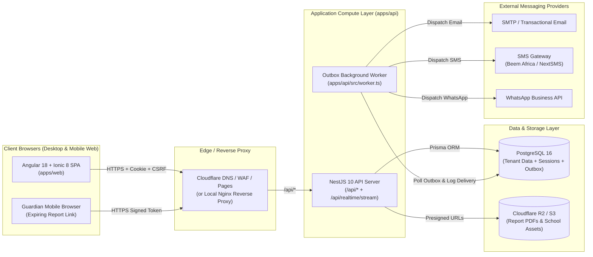
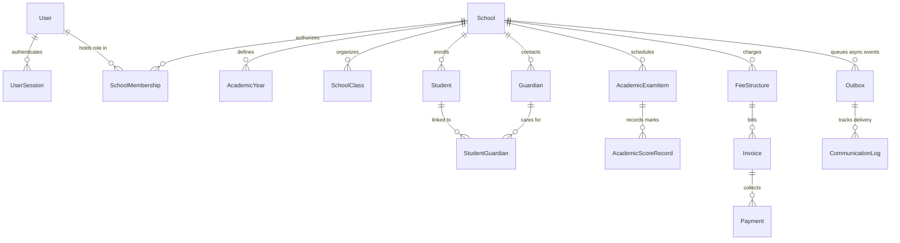
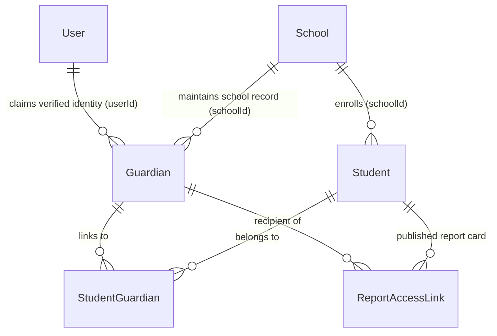

# SyncAcademy — End-to-End System Design & Architecture

This document is the authoritative technical design specification for SyncAcademy across the **Frontend (`apps/web`)**, **Backend (`apps/api`)**, **Database (`apps/api/prisma`)**, **Multi-Tenancy**, **Security**, **Performance**, **Multi-Channel Communications**, and **Architecture Decision Records (ADRs)**.

---

## 1. End-to-End System Topology

SyncAcademy is designed as a **modular, multi-tenant web platform** inside an npm workspaces monorepo. It avoids microservice sprawl and external message-broker dependencies (no Redis or Kafka required for MVP) by running three cohesive runtime components backed by **PostgreSQL 16**:

1. **Web Client (`apps/web`)**: Angular 18 + Ionic 8 single-page application serving role-based workspaces.
2. **REST & Realtime API Server (`apps/api` — `src/main.ts`)**: NestJS 10 HTTP server exposing `/api/*` REST endpoints and a Server-Sent Events (SSE) stream at `/api/realtime/stream`.
3. **Transactional Outbox Worker (`apps/api` — `src/worker.ts`)**: Background process polling the PostgreSQL `Outbox` table to dispatch emails, SMS, and WhatsApp messages reliably.



---

## 2. Frontend Design, UI Preservation & Layout Standards (`apps/web`)

### 2.1 Component & State Architecture
- **Framework**: Angular `^18.2.0` using **Standalone Components** (`standalone: true`), lazy-loaded routes (`loadComponent` in `src/app/app.routes.ts`), and **Angular Signals** (`signal`, `computed`).
- **UI System**: Custom SCSS design tokens (`src/styles.scss`) paired with `@ionic/angular ^8.0.0` and `ionicons ^7.0.0`.
- **Core State Services (`src/app/core/services/`)**:
  - `AuthService` (`auth.service.ts`) — Bootstraps `/api/auth/session`, manages login/logout/invitations/password-reset, and attaches `withCredentials: true` + `x-csrf-token` headers.
  - `SchoolService` (`school.service.ts`) — Manages active tenant context (`schoolId`), directory queries, bursar finance state, and live SSE invalidation streams (`/api/realtime/stream`).
  - `AcademicOperationsService` (`academic-operations.service.ts`) — Manages grading scales, assessments, marks entry, approvals, attendance, and report cards (`/api/schools/:schoolId/academics/*`).
  - `RegistrarOperationsService` (`registrar-operations.service.ts`) — Manages admissions, enrollments, promotions, transfers, and certificates (`/api/schools/:schoolId/registrar/*`).

### 2.2 Active Route Map
| Route Path | Component | Route Guards | Target Roles |
|---|---|---|---|
| `/` | `LandingPageComponent` | Public | Visitors, prospective schools |
| `/auth`, `/login` | `AuthPageComponent` | Public | All authenticating staff |
| `/accept-invitation` | `AcceptInvitationPageComponent` | Public (Token) | Invited admins & staff |
| `/reset-password` | `ResetPasswordPageComponent` | Public (Token) | Staff resetting passwords |
| `/super-admin` | `SuperAdminPageComponent` | `authGuard`, `superAdminGuard` | `SUPER_ADMIN` |
| `/school-setup`, `/school-admin` | `SchoolSetupPageComponent` | `authGuard`, `schoolSetupGuard` | `SCHOOL_ADMIN`, `HEAD_TEACHER`, `SUPER_ADMIN` |
| `/registrar` | `RegistrarPageComponent` | `authGuard`, `registrarGuard` | `REGISTRAR`, `SCHOOL_ADMIN`, `HEAD_TEACHER`, `SUPER_ADMIN` |
| `/bursar` | `BursarPageComponent` | `authGuard`, `bursarGuard` | `BURSAR`, `HEAD_TEACHER`, `SUPER_ADMIN` |
| `/headmaster`, `/head-oversight` | `HeadOversightPageComponent` | `authGuard`, `headTeacherGuard` | `HEAD_TEACHER`, `SUPER_ADMIN` |
| `/academic`, `/academic-setup` | `AcademicSetupPageComponent` | `authGuard` | `SCHOOL_ADMIN`, `HEAD_TEACHER`, `CLASS_TEACHER`, `TEACHER` |
| `/class-teacher`, `/teaching-responsibilities`, `/teacher` | `TeachingResponsibilitiesPageComponent` | `authGuard` | `CLASS_TEACHER`, `TEACHER`, `SCHOOL_ADMIN`, `HEAD_TEACHER` |

*(Note: Six unrouted legacy prototype components under `src/app/features/{academic,bursar/fee-guide,parent,student,teacher,teachers}` are preserved intact pending owner decision.)*

### 2.3 Strict UI Preservation & Responsive Layout Standards
The existing UI in `apps/web` is strictly protected—do not redesign screens, alter color palettes/typography, or replace components without explicit owner approval. All portal views adhere to these responsive standards:
- **Header & Column Containment**: Keep dashboard headers constrained beside the sidebar (`min-width: 0`, `max-width: 100%`, flex/grid wrapping) so titles and action buttons never overflow horizontally.
- **Resizable Desktop Sidebars**: Support user-resizable desktop sidebars between `270px` and `min(420px, 35vw)` via `--sidebar-size` and an accessible edge handle.
- **Compact Mobile Viewports**: Use the Ionic overlay menu capped to the viewport on mobile widths without forcing horizontal page scroll.
- **Scrollable Data Tables & Accessible Dialogs**: Wrap wide tables (marks sheets, student ledgers) in horizontal scroll containers (`min-width: 0`, `max-width: 100%`). Top-layer `<dialog>` modals use blurred backdrops, keyboard focus containment, and `Escape`/outside-click dismissal (blocked while a save is in flight).

### 2.4 Design Governance, Workflow & Canonical Designing-Skills Integration
For new user-facing workflows, components, or layout refinements, SyncAcademy enforces rigorous design engineering standards:

1. **Canonical Design-Skills Source**:
   - Primary design engineering repository: [`https://github.com/realmadede/Designing-Skills.git`](https://github.com/realmadede/Designing-Skills.git).
   - Pinned reviewed revision: `2d228630ba1446365f614a108cb8252f1feda202`.
   - External scripts or commands must never be executed automatically.
2. **Skill Selection & Compatibility Rubric**:
   - Select skills according to task relevance and Angular 18 + SCSS compatibility:
     - `skills/mobile-native/SKILL.md`: Mobile web polish (dynamic viewport units `100dvh`, removing 300ms tap delay via `touch-action: manipulation`, safe area insets `env(safe-area-inset-bottom)`, preventing iOS font zoom on inputs `< 16px`).
     - `skills/break-ui/SKILL.md`: Adversarial UI stress-testing with realistic worst-case data (Tanzanian multi-part names like "Mwanahamisi Abdallah Ndibalema", unbreakable email addresses, missing avatars, extreme TZS currency figures, zero-item empty states, 320px container widths, 200% browser zoom).
     - `skills/animate/SKILL.md` & `skills/animation-performance/SKILL.md`: 60fps composited animations (`transform` and `opacity` only, correct easing curves, zero layout thrashing).
     - `skills/emil-design-eng/SKILL.md` & `skills/apple-design/SKILL.md`: Subtle borders, semi-transparent shadows, and hierarchy.
   - **Excluded Frameworks**: React, React Native, Expo, Swift, Tailwind, or competing UI libraries (e.g., `animate-expo`, `write-swift`, `ask-sonner` are strictly excluded).
3. **Design System Preservation**:
   - The established design tokens, colors, gradients, typography, and class conventions in `apps/web/src/styles.scss` remain authoritative. External skills inform technique, polish, and edge-case handling—they do not replace SyncAcademy's brand or visual language.
4. **Design Proposal & Change Approval Requirements**:
   - Any new screen or component addition requires a design proposal specifying: component hierarchy, responsive breakpoint plan (320px to 1440px), accessibility compliance, and an adversarial worst-case data plan.
   - Strict product owner approval is required before touching existing active portal layouts or stylesheets.
5. **Responsive Testing Standards**:
   - Must be verified at 320px (compact mobile), 768px (tablet), 1024px (desktop), and 1440px (wide desktop). Zero horizontal page scrolling on mobile.
6. **Accessibility Requirements**:
   - WCAG 2.1 AA compliance: minimum 4.5:1 text contrast ratio, visible keyboard focus indicators, explicit `aria-label` attributes on icon-only buttons, and `<dialog>` keyboard containment.
7. **UI Acceptance Criteria**:
   - Zero TypeScript compile errors (`ng build`).
   - Passes all 8 automated portal workflow verification scripts.
   - Passes adversarial worst-case data checks without clipping or broken layouts.

---

## 3. Backend Design & Controller Architecture (`apps/api`)

### 3.1 Runtime Entrypoints & Core Services
- `src/main.ts` -> `src/bootstrap.ts` (`createApiServer`): Configures CORS (`APP_ORIGIN`, `credentials: true`), security headers (`X-Content-Type-Options: nosniff`, `X-Frame-Options: DENY`, `Referrer-Policy: no-referrer`), and global exception handling (`HttpErrorFilter`).
- `src/worker.ts` (`startWorker`): Polls `Outbox` every `WORKER_POLL_MS`, claims pending events atomically, dispatches messages, writes `CommunicationLog` records, and applies exponential backoff on transient failures.
- `src/platform.service.ts` (`PlatformService`): Central service handling session validation, CSRF checks, RBAC enforcement, transactional outbox enqueueing, and `AuditLog` persistence.
- `src/database/database.service.ts` (`DatabaseService`): Prisma client lifecycle wrapper.

### 3.2 REST Controller Inventory (`src/app.module.ts`)
1. **`ApiController` (`src/api.controller.ts`)**: Health (`/api/health`), session auth (`/api/auth/*`), password resets, invitation acceptance, platform settings (`/api/platform-settings`), Super Admin school management (`/api/schools`), staff invitations (`/api/invitations`), audit logs (`/api/audit-logs`), and public contact inquiries (`/api/contact-submissions`).
2. **`RegistryController` (`src/registry.controller.ts`)**: School setup and directory CRUD for `AcademicYear`, `Term`, `Level`, `SchoolClass`, `Subject`, `TeacherSubjectAssignment`, `Student`, and `Guardian`.
3. **`RegistryWorkflowsController` (`src/registry-workflows.controller.ts`)**: Registrar operations under `/api/schools/:schoolId/registrar/*` (`applications`, `enrollments`, `promotions`, `transfers`, `certificates`) and `/api/schools/:schoolId/overview`.
4. **`AcademicController` (`src/academic.controller.ts`)**: Academic workspace, grading scales, teacher assignments, exams, marks entry/validation, multi-stage approvals, attendance, and report cards under `/api/schools/:schoolId/academics/*`.
5. **`BursarController` (`src/bursar.controller.ts`)**: Financial workspace, fee structures, student invoices, payments/receipts, and fee adjustment requests under `/api/schools/:schoolId/bursar/*`.
6. **`RealtimeController` (`src/realtime.gateway.ts`)**: Tenant-scoped Server-Sent Events stream at `/api/realtime/stream`.

---

## 4. Database Schema & Multi-Tenancy Design (`apps/api/prisma`)

### 4.1 Shared-Database, Shared-Schema Multi-Tenancy
SyncAcademy uses **PostgreSQL 16 + Prisma 5** (`apps/api/prisma/schema.prisma`, 39 models, 19 enums across 14 migrations). Every school is a tenant root (`School.id`), and all tenant-owned tables carry a mandatory `schoolId` column with composite indexes starting with `schoolId`.



### 4.2 Tenant Isolation & Authorization Invariants
1. **Explicit Membership Check**: Every request targeting `:schoolId` must verify that the authenticated viewer is either `SUPER_ADMIN` or holds an `ACTIVE` `SchoolMembership` for that exact `schoolId` with an authorized `MembershipRole`.
2. **Composite Query Scoping**: Every Prisma read, update, or delete on a child model must constrain both `id` and `schoolId` (`where: { id, schoolId }`) to prevent cross-tenant IDOR.
3. **Teacher Assignment Scoping**: `CLASS_TEACHER` and `TEACHER` users may only modify marks or attendance for classes and subjects assigned to them in `TeacherSubjectAssignment` / `AcademicClassAssignment`.

---

## 5. Security Architecture & Credential Governance

1. **Stateful Opaque Sessions & CSRF Protection**:
   - Sessions are stored in PostgreSQL (`UserSession`) as SHA-256 hashes (`sessionTokenHash`) and delivered via `HttpOnly`, `SameSite=Lax` cookies (`syncacademy_session`, with `Secure` enabled in production).
   - State-mutating requests (`POST`, `PUT`, `PATCH`, `DELETE`) require an `x-csrf-token` header matching `UserSession.csrfTokenHash`.
2. **Cryptography**:
   - Passwords are hashed using **Argon2id** (`apps/api/src/security.ts`).
   - Sensitive database settings (`PlatformSetting.smtpPassEncrypted`) are encrypted at rest using **AES-256-GCM** keyed by `DATA_ENCRYPTION_KEY`.
3. **Zero Committed Secrets & History Remediation**:
   - All environment variables are validated at startup via **Zod** in `apps/api/src/config.ts`.
   - In Phase 1 (commit `e4adfa8`), all previously committed SMTP credentials and personal developer emails were removed from tracked files. The compromised Google App Password must be revoked in Google Account settings.
   - If the repository owner approves scrubbing historical commit `66d6d71`, run `git filter-repo --replace-text` on a mirror clone and force-push cleaned branches/tags.

---

## 6. Performance, Concurrency & Scalability Design

- **Realtime Invalidation & Client Coalescing**:
  - Domain writes publish lightweight school-scoped invalidation notices over `RealtimeBus` (supporting multi-instance PostgreSQL `LISTEN / NOTIFY` via `REALTIME_TRANSPORT=postgres`).
  - Frontend services coalesce concurrent reads and use revision checks (`workspaceRevision`) plus revision-bound save patches to avoid redundant full-workspace downloads.
- **Optimistic Concurrency (`HTTP 409 Conflict`)**:
  - Student profiles, enrollment movements, marks submissions, and attendance registers enforce version/revision checks inside serializable transactions so stale browser tabs cannot overwrite newer committed records.
- **Query & Storage Scalability**:
  - Finance balance summaries use school-scoped grouped CTEs rather than correlated per-student subqueries.
  - Academic portal storage uses normalized relational tables (`AcademicExamItem`, `AcademicScoreRecord`, `AcademicApprovalItem`, `AcademicAttendanceSession`, `AcademicReportCardRecord`) indexed by `schoolId`.

---

## 7. Guardian Identity & Multi-Channel Communication Architecture

### 7.1 Cross-School Guardian Data Model
In Tanzanian schools, parents frequently have children enrolled across multiple SyncAcademy primary and secondary schools. SyncAcademy separates the local guardian school directory contact (`Guardian`) from global parent identity (`User`), joined to students via `StudentGuardian`:



- **Additive Schema Extensions**:
  - `Guardian`: `userId` (links to global `User`), `phoneE164`, `whatsappPhoneE164`, `preferredChannel` (`SMS`, `WHATSAPP`, `EMAIL`), `preferredLanguage` (`sw` / `en`), `phoneVerifiedAt`, `optOutSms`, `optOutWhatsapp`.
  - Multiple guardians per student (`StudentGuardian.isPrimary`, `canReceiveNotifications`), and multiple students across schools linked to one verified guardian identity.

### 7.2 Pluggable Provider Abstractions (SMS, WhatsApp, Email)
All communication channels implement a unified interface under `apps/api/src/communication/`:
- **`SmsProvider`**: Direct integration with Tanzanian SMS aggregators (**NextSMS** as primary, or Beem Africa) supporting local TZS billing, direct MNO routes (Vodacom, Airtel, Tigo/Mixx, Halotel), and custom Sender ID (`SYNCACADEMY`).
  - Implemented in `apps/api/src/communication/providers/nextsms-sms.provider.ts`.
  - Base URL: `https://messaging-service.co.tz`
  - Authentication: Bearer token (`Authorization: Bearer <token>`) or RFC2045-MIME Basic auth.
  - Endpoints: Single SMS `POST /api/sms/v2/text/single`, Multi SMS `POST /api/sms/v2/text/multi`, Test Single SMS `POST /api/sms/v2/test/text/single` (free testing mode).
  - Character encoding: GSM-7 (160 single / 153 concatenated) and UCS-2 (70 single / 67 concatenated).
  - Phone normalization: E.164 digits-only format (`255XXXXXXXXX`).
  - Anti-flooding filters: NextSMS enforces a default limit of 20 varied messages and 6 identical messages per hour to a single recipient.
- **`WhatsAppProvider`**: NextSMS WhatsApp Gateway (`POST /api/whatsapp/v2/text/single`, Test mode `/api/whatsapp/v2/test/text/single`).
  - Implemented in `apps/api/src/communication/providers/nextsms-whatsapp.provider.ts`.
  - Requires pre-registered WhatsApp account and approved templates in NextSMS dashboard (`Channels -> WhatsApp Channel -> WhatsApp Gateway`).
  - Supports template parameter interpolation (`attributes`), document/PDF attachments (`document`), and recipient mapping.
  - Fallback indication: Code 111 (`REJECTED_MISSING_OUTLET`) triggers automatic fallback to SMS.
- **`EmailProvider`**: Nodemailer SMTP (`apps/api/src/communication/providers/smtp-email.provider.ts`) reading encrypted credentials from `PlatformSetting` or environment variables.
- **`MockCommunicationProvider`**: In-memory test provider (`apps/api/src/communication/providers/mock-communication.provider.ts`) for deterministic unit and workflow tests without network traffic.

### 7.3 Delivery Reports, Webhooks & Transactional Outbox Integration
- **NextSMS Webhook Integration (`apps/api/src/communication/webhooks/nextsms-webhook.ts`)**:
  - Registered in NextSMS Dashboard (`Customer Info -> Customization -> Webhooks`) with shared verify token.
  - Receives live delivery updates: `DELIVERED` (id 73), `EXPIRED` (id 74), `UNDELIVERABLE` (id 76), `REJECTED` (id 79), and WhatsApp customer responses (`READ`, inbound text).
  - Webhook processing updates `CommunicationLog` status asynchronously.
  - Fallback HTTP Query API (`GET /api/v2/reports?messageId=...`) used only for manual reconciliation (NextSMS documents HTTP Query as one-time retrieval to be discontinued in favor of webhooks).
- **Transactional Outbox Integration (`worker.ts`)**:
  - Domain state changes (e.g. report card publishing, fee payment receipting) and outbox rows are committed in a single ACID transaction (`prisma.$transaction`).
  - Worker polls outbox every 5s, dispatches via the guardian's preferred channel (`WHATSAPP` -> `SMS` -> `EMAIL`), records delivery telemetry and unit costs in `CommunicationLog`, and executes exponential backoff on retryable failures (system error 64, network 53). Non-retryable errors (insufficient credits 57, missing template outlet 111) trigger instant failover to secondary channels.

### 7.4 Secure, Expiring Report-Access Links (`ReportAccessLink`)
Allows parents to view and download term report cards from an SMS, WhatsApp message, or Email without requiring pre-created portal passwords:
```prisma
model ReportAccessLink {
  id                  String    @id @default(cuid())
  schoolId            String
  reportCardId        String
  studentId           String
  guardianId          String
  tokenHash           String    @unique // SHA-256 of 256-bit URL token
  expiresAt           DateTime  // Default: +14 days
  revokedAt           DateTime?
  maxAccessCount      Int       @default(25)
  accessCount         Int       @default(0)
  requirePhoneLast4   Boolean   @default(true)
  createdAt           DateTime  @default(now())
}
```
- High-entropy 256-bit URL token (`/r/<token>`), unguessable and stored only as SHA-256 hash.
- Lightweight identity challenge: guardian enters the last 4 digits of their registered phone number before viewing the report card (rate-limited to 5 attempts per 15 minutes).
- Instant revocation by school headmasters/registrars and immutable audit logging on every access attempt.

---

## 8. Architecture Decision Records (ADRs)

- **ADR-001 (Frontend Stack)**: Retain **Angular 18 + Ionic 8** (`apps/web`) and strictly preserve the implemented UI portals rather than rewriting into another framework.
- **ADR-002 (Authentication)**: Use **PostgreSQL-backed opaque sessions (`UserSession`) + CSRF headers** instead of stateless JWTs in `localStorage`, enabling instant session revocation when staff memberships are suspended.
- **ADR-003 (Async Messaging & Outbox)**: Use the **PostgreSQL Transactional Outbox (`Outbox` + `worker.ts`)** instead of Redis/Kafka, guaranteeing atomic event enqueueing and low infrastructure cost.
- **ADR-004 (Multi-Tenancy)**: Use a **shared PostgreSQL schema discriminated by `schoolId`** with global `User` identity so staff and cross-school guardians can hold relationships across multiple schools.
- **ADR-005 (Academic Schema Unification)**: Complete consolidation of legacy academic tables (`Examination`, `Mark`, `ReportCard`) into the active normalized `Academic*` relational tables in Phase 2.
