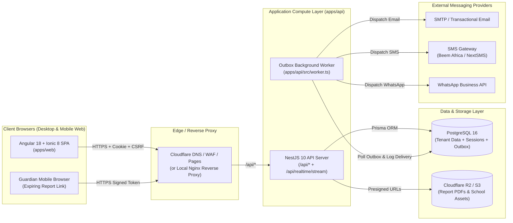
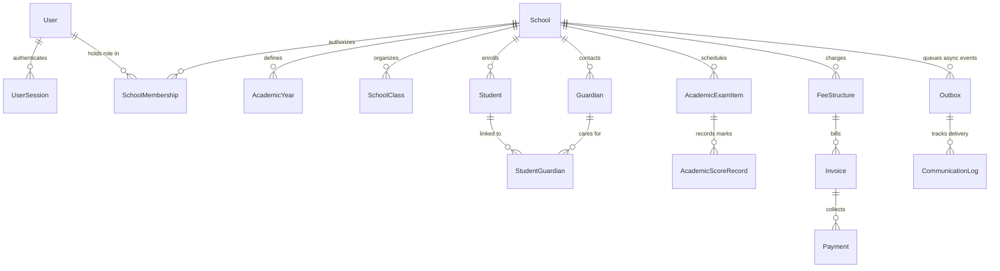
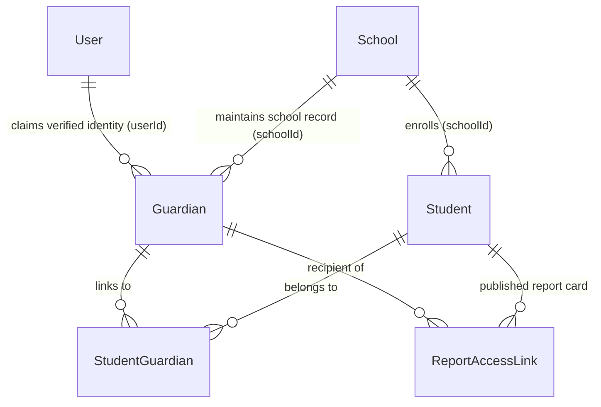

# SyncAcademy — End-to-End System Design & Architecture

This document is the authoritative technical design specification for SyncAcademy across the **Frontend (`apps/web`)**, **Backend (`apps/api`)**, **Database (`apps/api/prisma`)**, **Multi-Tenancy**, **Security**, **Performance**, **Multi-Channel Communications**, and **Architecture Decision Records (ADRs)**.

---

## 1. End-to-End System Topology

### Current implementation: public school intake

`POST /api/v1/demo-requests` validates a public demo request, applies PostgreSQL-backed public form limits, deduplicates identical school/applicant requests over 24 hours, creates a `PlatformLead`, and queues an acknowledgment in the transactional outbox. `POST /api/v1/contact` uses the same protection service. Public form attempts are stored as hashed email and IP identifiers; restricted and accepted events are visible only to Super Admins through `/api/v1/platform/public-forms/activity`. Authorized administrators can block or unblock an IP for public form submissions through `/api/v1/platform/public-forms/blocks`, with audit records. The worker removes expired blocks and public form telemetry after the configured retention period.

The existing `/api/v1/platform/leads/:leadId/convert` path provisions a school only after a Super Admin has moved an unconverted lead to `won`. It uses the lead's designated Headmaster contact for the pending invitation. Legacy leads without that contact retain their previous applicant invitation behavior. Conversion checks school code and matching school name and region, and the existing idempotency transaction prevents repeat provisioning.

The lead activity table records submissions, edits, stage changes, conversion, internal notes, contact attempts, and demo milestones. Super Admins add activities through `POST /api/v1/platform/leads/:leadId/activities`; each entry is returned with the lead list for the existing details panel.

SyncAcademy is designed as a **modular, multi-tenant web platform** inside an npm workspaces monorepo. It avoids microservice sprawl and external message-broker dependencies (no Redis or Kafka required for MVP) by running three cohesive runtime components backed by **PostgreSQL 16**:

1. **Web Client (`apps/web`)**: Angular 18 + Ionic 8 single-page application serving role-based workspaces.
2. **REST & Realtime API Server (`apps/api` — `src/main.ts`)**: NestJS 10 HTTP server exposing `/api/*` REST endpoints and a Server-Sent Events (SSE) stream at `/api/realtime/stream`.
3. **Transactional Outbox Worker (`apps/api` — `src/worker.ts`)**: Background process polling the PostgreSQL `Outbox` table to dispatch emails, SMS, and WhatsApp messages reliably.

---

## 2. Frontend Design, UI Preservation & Layout Standards (`apps/web`)

### 2.1 Component & State Architecture
- **Framework**: Angular `^18.2.0` using **Standalone Components** (`standalone: true`), lazy-loaded routes (`loadComponent` in `src/app/app.routes.ts`), and **Angular Signals** (`signal`, `computed`).
- **UI System**: Custom SCSS design tokens (`src/styles.scss`) paired with `@ionic/angular ^8.0.0` and `ionicons ^7.0.0`.
- **Application startup**: `AppComponent` displays a responsive SVG graduation-cap preloader while the initial router navigation is unresolved. The cap float and two-second loading-ring rotation use independent CSS transforms; successful, canceled, or failed navigation fades the overlay out over 500ms, with a bounded initialization watchdog and reduced-motion support.
- **Core State Services (`src/app/core/services/`)**:
  - `AuthService` (`auth.service.ts`) — Bootstraps `/api/auth/session`, manages login/logout/invitations/password-reset, and attaches `withCredentials: true` + `x-csrf-token` headers.
  - `SchoolService` (`school.service.ts`) — Manages active tenant context (`schoolId`), directory queries, bursar finance state, and live SSE invalidation streams (`/api/realtime/stream`).
  - `AcademicOperationsService` (`academic-operations.service.ts`) — Manages grading scales, assessments, marks entry, approvals, attendance, and report cards (`/api/schools/:schoolId/academics/*`).
  - `RegistrarOperationsService` (`registrar-operations.service.ts`) — Manages admissions, enrollments, promotions, transfers, and certificates (`/api/schools/:schoolId/registrar/*`).

### 2.2 Active Route Map
| Route Path | Component | Route Guards | Target Roles |
|---|---|---|---|
| `/` | `LandingPageComponent` | Public | Visitors, prospective schools |
| `/auth`, `/login` | `AuthPageComponent` | Public | All authenticating staff |
| `/accept-invitation` | `AcceptInvitationPageComponent` | Public (Token) | Invited admins & staff |
| `/reset-password` | `ResetPasswordPageComponent` | Public (Token) | Staff resetting passwords |
| `/super-admin` | `SuperAdminPageComponent` | `authGuard`, `superAdminGuard` | `SUPER_ADMIN` |
| `/school-setup`, `/school-admin` | `SchoolSetupPageComponent` | `authGuard`, `schoolSetupGuard` | `SCHOOL_ADMIN`, `HEAD_TEACHER`, `SUPER_ADMIN` |
| `/registrar` | `RegistrarPageComponent` | `authGuard`, `registrarGuard` | `REGISTRAR`, `SCHOOL_ADMIN`, `HEAD_TEACHER`, `SUPER_ADMIN` |
| `/bursar` | `BursarPageComponent` | `authGuard`, `bursarGuard` | `BURSAR`, `HEAD_TEACHER`, `SUPER_ADMIN` |
| `/headmaster`, `/head-oversight` | `HeadOversightPageComponent` | `authGuard`, `headTeacherGuard` | `HEAD_TEACHER`, `SUPER_ADMIN` |
| `/academic`, `/academic-setup` | `AcademicSetupPageComponent` | `authGuard` | `SCHOOL_ADMIN`, `HEAD_TEACHER`, `CLASS_TEACHER`, `TEACHER` |
| `/class-teacher`, `/teaching-responsibilities`, `/teacher` | `TeachingResponsibilitiesPageComponent` | `authGuard` | `CLASS_TEACHER`, `TEACHER`, `SCHOOL_ADMIN`, `HEAD_TEACHER` |

*(Note: Six unrouted legacy prototype components under `src/app/features/{academic,bursar/fee-guide,parent,student,teacher,teachers}` are preserved intact pending owner decision.)*

### 2.3 Strict UI Preservation & Responsive Layout Standards
The existing UI in `apps/web` is strictly protected—do not redesign screens, alter color palettes/typography, or replace components without explicit owner approval. All portal views adhere to these responsive standards:
- **Header & Column Containment**: Keep dashboard headers constrained beside the sidebar (`min-width: 0`, `max-width: 100%`, flex/grid wrapping) so titles and action buttons never overflow horizontally.
- **Resizable Desktop Sidebars**: Support user-resizable desktop sidebars between `270px` and `min(420px, 35vw)` via `--sidebar-size` and an accessible edge handle.
- **Compact Mobile Viewports**: Use the Ionic overlay menu capped to the viewport on mobile widths without forcing horizontal page scroll.
- **Scrollable Data Tables & Accessible Dialogs**: Wrap wide tables (marks sheets, student ledgers) in horizontal scroll containers (`min-width: 0`, `max-width: 100%`). Top-layer `<dialog>` modals use blurred backdrops, keyboard focus containment, and `Escape`/outside-click dismissal (blocked while a save is in flight).

### 2.4 Design Governance, Workflow & Canonical Designing-Skills Integration
For new user-facing workflows, components, or layout refinements, SyncAcademy enforces rigorous design engineering standards:

1. **Canonical Design-Skills Source**:
   - Primary design engineering repository: [`https://github.com/realmadede/Designing-Skills.git`](https://github.com/realmadede/Designing-Skills.git).
   - Pinned reviewed revision: `2d228630ba1446365f614a108cb8252f1feda202`.
   - External scripts or commands must never be executed automatically.
2. **Skill Selection & Compatibility Rubric**:
   - Select skills according to task relevance and Angular 18 + SCSS compatibility:
     - `skills/mobile-native/SKILL.md`: Mobile web polish (dynamic viewport units `100dvh`, removing 300ms tap delay via `touch-action: manipulation`, safe area insets `env(safe-area-inset-bottom)`, preventing iOS font zoom on inputs `< 16px`).
     - `skills/break-ui/SKILL.md`: Adversarial UI stress-testing with realistic worst-case data (Tanzanian multi-part names like "Mwanahamisi Abdallah Ndibalema", unbreakable email addresses, missing avatars, extreme TZS currency figures, zero-item empty states, 320px container widths, 200% browser zoom).
     - `skills/animate/SKILL.md` & `skills/animation-performance/SKILL.md`: 60fps composited animations (`transform` and `opacity` only, correct easing curves, zero layout thrashing).
     - `skills/emil-design-eng/SKILL.md` & `skills/apple-design/SKILL.md`: Subtle borders, semi-transparent shadows, and hierarchy.
   - **Excluded Frameworks**: React, React Native, Expo, Swift, Tailwind, or competing UI libraries (e.g., `animate-expo`, `write-swift`, `ask-sonner` are strictly excluded).
3. **Design System Preservation**:
   - The established design tokens, colors, gradients, typography, and class conventions in `apps/web/src/styles.scss` remain authoritative. External skills inform technique, polish, and edge-case handling—they do not replace SyncAcademy's brand or visual language.
4. **Design Proposal & Change Approval Requirements**:
   - Any new screen or component addition requires a design proposal specifying: component hierarchy, responsive breakpoint plan (320px to 1440px), accessibility compliance, and an adversarial worst-case data plan.
   - Strict product owner approval is required before touching existing active portal layouts or stylesheets.
5. **Responsive Testing Standards**:
   - Must be verified at 320px (compact mobile), 768px (tablet), 1024px (desktop), and 1440px (wide desktop). Zero horizontal page scrolling on mobile.
6. **Accessibility Requirements**:
   - WCAG 2.1 AA compliance: minimum 4.5:1 text contrast ratio, visible keyboard focus indicators, explicit `aria-label` attributes on icon-only buttons, and `<dialog>` keyboard containment.
7. **UI Acceptance Criteria**:
   - Zero TypeScript compile errors (`ng build`).
   - Passes all 8 automated portal workflow verification scripts.
   - Passes adversarial worst-case data checks without clipping or broken layouts.

---

## 3. Backend Design & Controller Architecture (`apps/api`)

### 3.1 Runtime Entrypoints & Core Services
- `src/main.ts` -> `src/bootstrap.ts` (`createApiServer`): Configures CORS (`APP_ORIGIN`, `credentials: true`), security headers (`X-Content-Type-Options: nosniff`, `X-Frame-Options: DENY`, `Referrer-Policy: no-referrer`), and global exception handling (`HttpErrorFilter`).
- `src/worker.ts` (`startWorker`): Polls `Outbox` every `WORKER_POLL_MS`, claims pending events atomically, dispatches messages, writes `CommunicationLog` records, and applies exponential backoff on transient failures.
- `src/platform.service.ts` (`PlatformService`): Central service handling session validation, CSRF checks, RBAC enforcement, transactional outbox enqueueing, and `AuditLog` persistence.
- `src/database/database.service.ts` (`DatabaseService`): Prisma client lifecycle wrapper.

### 3.2 REST Controller Inventory (`src/app.module.ts`)
1. **`ApiController` (`src/api.controller.ts`)**: Health (`/api/health`), session auth (`/api/auth/*`), password resets, invitation acceptance, platform settings (`/api/platform-settings`), Super Admin school management (`/api/schools`), staff invitations (`/api/invitations`), audit logs (`/api/audit-logs`), and public contact inquiries (`/api/contact-submissions`).
2. **`RegistryController` (`src/registry.controller.ts`)**: School setup and directory CRUD for `AcademicYear`, `Term`, `Level`, `SchoolClass`, `Subject`, `TeacherSubjectAssignment`, `Student`, and `Guardian`.
3. **`RegistryWorkflowsController` (`src/registry-workflows.controller.ts`)**: Registrar operations under `/api/schools/:schoolId/registrar/*` (`applications`, `enrollments`, `promotions`, `transfers`, `certificates`) and `/api/schools/:schoolId/overview`.
4. **`AcademicController` (`src/academic.controller.ts`)**: Academic workspace, grading scales, teacher assignments, exams, marks entry/validation, multi-stage approvals, attendance, and report cards under `/api/schools/:schoolId/academics/*`.
5. **`BursarController` (`src/bursar.controller.ts`)**: Financial workspace, fee structures, student invoices, payments/receipts, and fee adjustment requests under `/api/schools/:schoolId/bursar/*`.
6. **`RealtimeController` (`src/realtime.gateway.ts`)**: Tenant-scoped Server-Sent Events stream at `/api/realtime/stream`.

---

## 4. Database Schema & Multi-Tenancy Design (`apps/api/prisma`)

### 4.1 Shared-Database, Shared-Schema Multi-Tenancy
SyncAcademy uses **PostgreSQL 16 + Prisma 5** (`apps/api/prisma/schema.prisma`, 39 models, 19 enums across 14 migrations). Every school is a tenant root (`School.id`), and all tenant-owned tables carry a mandatory `schoolId` column with composite indexes starting with `schoolId`.

### 4.2 Tenant Isolation & Authorization Invariants
1. **Explicit Membership Check**: Every request targeting `:schoolId` must verify that the authenticated viewer is either `SUPER_ADMIN` or holds an `ACTIVE` `SchoolMembership` for that exact `schoolId` with an authorized `MembershipRole`.
2. **Composite Query Scoping**: Every Prisma read, update, or delete on a child model must constrain both `id` and `schoolId` (`where: { id, schoolId }`) to prevent cross-tenant IDOR.
3. **Teacher Assignment Scoping**: `CLASS_TEACHER` and `TEACHER` users may only modify marks or attendance for classes and subjects assigned to them in `TeacherSubjectAssignment` / `AcademicClassAssignment`.

---

## 5. Security Architecture & Credential Governance

1. **Stateful Sessions & Same-Origin Write Protection**:
   - The current runtime stores Express sessions in PostgreSQL (`session`) and delivers the session identifier in an `HttpOnly`, `SameSite=Lax` cookie named `sa.sid` (`Secure` in production).
   - State-mutating requests (`POST`, `PUT`, `PATCH`, `DELETE`) must pass the configured same-origin, `X-Requested-With`, and JSON content-type checks in `apps/api/src/main.ts`.
2. **Cryptography**:
   - Passwords are hashed using **Argon2id** (`apps/api/src/security.ts`).
   - Sensitive database settings (`PlatformSetting.smtpPassEncrypted`) are encrypted at rest using **AES-256-GCM** keyed by `DATA_ENCRYPTION_KEY`.
3. **Zero Committed Secrets & History Remediation**:
   - All environment variables are validated at startup via **Zod** in `apps/api/src/config.ts`.
   - In Phase 1 (commit `e4adfa8`), all previously committed SMTP credentials and personal developer emails were removed from tracked files. The compromised Google App Password must be revoked in Google Account settings.
   - If the repository owner approves scrubbing historical commit `66d6d71`, run `git filter-repo --replace-text` on a mirror clone and force-push cleaned branches/tags.

---

## 6. Performance, Concurrency & Scalability Design

- **Realtime Invalidation & Client Coalescing**:
  - Domain writes publish lightweight school-scoped invalidation notices over `RealtimeBus` (supporting multi-instance PostgreSQL `LISTEN / NOTIFY` via `REALTIME_TRANSPORT=postgres`).
  - Frontend services coalesce concurrent reads and use revision checks (`workspaceRevision`) plus revision-bound save patches to avoid redundant full-workspace downloads.
- **Optimistic Concurrency (`HTTP 409 Conflict`)**:
  - Student profiles, enrollment movements, marks submissions, and attendance registers enforce version/revision checks inside serializable transactions so stale browser tabs cannot overwrite newer committed records.
- **Query & Storage Scalability**:
  - Finance balance summaries use school-scoped grouped CTEs rather than correlated per-student subqueries.
  - Academic portal storage uses normalized relational tables (`AcademicExamItem`, `AcademicScoreRecord`, `AcademicApprovalItem`, `AcademicAttendanceSession`, `AcademicReportCardRecord`) indexed by `schoolId`.
  - Super Admin school workspaces request summary views for school, year, and class cards without loading student records or the full teaching-assignment relation set. Student rosters are fetched through the school-scoped registry endpoint only after a class is selected, with server-side search and pagination constrained by academic year and active class enrollment.
  - The Super Admin Teacher Assignments view uses `GET /api/v1/schools/:id/teacher-assignments` with a required school-owned `yearId`, optional name/class/subject/role filters, and page sizes of 12, 20, 24, or 48. The API paginates unique teacher memberships before returning each selected teacher's year-scoped subject/class assignments and active class-teacher responsibilities; school access is authorized at the API boundary.

---

## 7. Guardian Identity & Multi-Channel Communication Architecture

### 7.1 Cross-School Guardian Data Model
In Tanzanian schools, parents frequently have children enrolled across multiple SyncAcademy primary and secondary schools. SyncAcademy separates the local guardian school directory contact (`Guardian`) from global parent identity (`User`), joined to students via `StudentGuardian`:

- **Additive Schema Extensions**:
  - `Guardian`: `userId` (links to global `User`), `phoneE164`, `whatsappPhoneE164`, `preferredChannel` (`SMS`, `WHATSAPP`, `EMAIL`), `preferredLanguage` (`sw` / `en`), `phoneVerifiedAt`, `optOutSms`, `optOutWhatsapp`.
  - Multiple guardians per student (`StudentGuardian.isPrimary`, `canReceiveNotifications`), and multiple students across schools linked to one verified guardian identity.

### 7.2 Pluggable Provider Abstractions (SMS, WhatsApp, Email)
All communication channels implement a unified interface under `apps/api/src/communication/`:
- **`SmsProvider`**: Direct integration with Tanzanian SMS aggregators (**NextSMS** as primary, or Beem Africa) supporting local TZS billing, direct MNO routes (Vodacom, Airtel, Tigo/Mixx, Halotel), and custom Sender ID (`SYNCACADEMY`).
  - Implemented in `apps/api/src/communication/providers/nextsms-sms.provider.ts`.
  - Base URL: `https://messaging-service.co.tz`
  - Authentication: Bearer token (`Authorization: Bearer <token>`) or RFC2045-MIME Basic auth.
  - Endpoints: Single SMS `POST /api/sms/v2/text/single`, Multi SMS `POST /api/sms/v2/text/multi`, Test Single SMS `POST /api/sms/v2/test/text/single` (free testing mode).
  - Character encoding: GSM-7 (160 single / 153 concatenated) and UCS-2 (70 single / 67 concatenated).
  - Phone normalization: E.164 digits-only format (`255XXXXXXXXX`).
  - Anti-flooding filters: NextSMS enforces a default limit of 20 varied messages and 6 identical messages per hour to a single recipient.
- **`WhatsAppProvider`**: NextSMS WhatsApp Gateway (`POST /api/whatsapp/v2/text/single`, Test mode `/api/whatsapp/v2/test/text/single`).
  - Implemented in `apps/api/src/communication/providers/nextsms-whatsapp.provider.ts`.
  - Requires pre-registered WhatsApp account and approved templates in NextSMS dashboard (`Channels -> WhatsApp Channel -> WhatsApp Gateway`).
  - Supports template parameter interpolation (`attributes`), document/PDF attachments (`document`), and recipient mapping.
  - Fallback indication: Code 111 (`REJECTED_MISSING_OUTLET`) triggers automatic fallback to SMS.
- **`EmailProvider`**: 
  - **Resend** (`apps/api/src/communication/providers/resend-email.provider.ts`): Primary transactional email provider supporting modern API key authentication, verified sending domains, and Svix webhook signatures.
  - **Nodemailer SMTP** (`apps/api/src/communication/providers/smtp-email.provider.ts`): Fallback email provider reading credentials from `PlatformSetting` or environment variables.
- **`MockCommunicationProvider`**: In-memory test provider (`apps/api/src/communication/providers/mock-communication.provider.ts`) for deterministic unit and workflow tests without network traffic.

### 7.3 Delivery Reports, Webhooks & Transactional Outbox Integration
- **NextSMS & Resend Webhook Integration (`apps/api/src/webhook.controller.ts`)**:
  - NextSMS callbacks require the configured `NEXTSMS_WEBHOOK_VERIFY_TOKEN`; requests are rejected if it is absent.
  - Delivery reports: `POST /api/v1/webhooks/nextsms/delivery` updates `CommunicationLog` status (`DELIVERED`, `READ`, `UNDELIVERABLE`, `REJECTED`, etc.).
  - Inbound WhatsApp replies: `POST /api/v1/webhooks/nextsms/inbound` parses customer messages and automatically executes opt-out regulations on keywords (`STOP`, `SIMAMA`, `ONDOA`, `UNSUBSCRIBE`).
  - Resend email webhooks: `POST /api/v1/webhooks/resend` handles `email.delivered`, `email.bounced`, `email.complained`.
  - Webhooks are exempt from browser Origin and CSRF token restrictions. NextSMS uses its configured shared token; Resend verifies the Svix HMAC signature over the captured raw body and rejects timestamps outside a five-minute window. Missing verification configuration fails closed.
- **Transactional Outbox Integration (`worker.ts`)**:
  - Domain state changes (e.g. report card publishing, fee payment receipting) and outbox rows are committed in a single ACID transaction (`prisma.$transaction`).
  - Worker polls outbox every second, dispatches via the target channel (`SMS`, `WHATSAPP`, `EMAIL`), updates `CommunicationLog` telemetry, and applies exponential backoff on retryable errors. If WhatsApp delivery encounters non-retryable issues, it automatically falls back to SMS. Messages exceeding 8 attempts are transitioned to dead-letter state (`failedAt`).

### 7.4 Secure, Expiring Report-Access Links (`ReportAccessLink`) & Public Mobile Viewer
Allows parents to view and download term report cards from an SMS, WhatsApp message, or Email without requiring pre-created portal passwords:
- High-entropy 256-bit URL token (`/r/<token>`), unguessable and stored only as SHA-256 hash in `ReportAccessLink.tokenHash`.
- Lightweight identity challenge: guardian enters the last 4 digits of their registered phone number (or 6-digit SMS OTP code for heightened security) before viewing the report card (rate-limited to 10 attempts per 10 minutes).
- Public mobile web route `/r/:token` (`apps/web/src/app/features/public/report-viewer.page.ts`) adhering to mobile-native polish (safe-area insets, responsive results table, NECTA-aligned grades, print styling).
- School staff can publish report links with notifications in bulk (`POST /api/v1/schools/:schoolId/reports/publish-with-links`) and instantly revoke active links with reason tracking (`POST /api/v1/schools/:schoolId/reports/links/:linkId/revoke`).

---

## 8. Architecture Decision Records (ADRs)

- **ADR-001 (Frontend Stack)**: Retain **Angular 18 + Ionic 8** (`apps/web`) and strictly preserve the implemented UI portals rather than rewriting into another framework.
- **ADR-002 (Authentication)**: Use **PostgreSQL-backed opaque sessions (`UserSession`) + CSRF headers** instead of stateless JWTs in `localStorage`, enabling instant session revocation when staff memberships are suspended.
- **ADR-003 (Async Messaging & Outbox)**: Use the **PostgreSQL Transactional Outbox (`Outbox` + `worker.ts`)** instead of Redis/Kafka, guaranteeing atomic event enqueueing and low infrastructure cost.
- **ADR-004 (Multi-Tenancy)**: Use a **shared PostgreSQL schema discriminated by `schoolId`** with global `User` identity so staff and cross-school guardians can hold relationships across multiple schools.
- **ADR-005 (Academic Schema Unification)**: Complete consolidation of legacy academic tables (`Examination`, `Mark`, `ReportCard`) into the active normalized `Academic*` relational tables in Phase 2.
- **ADR-006 (Payment Provider Safety Boundary)**: School subscription and credit purchases use a pluggable `PaymentProvider`. The mock provider is enabled only for tests or when explicitly enabled in development. No production payment provider is configured in the current implementation, so payment initiation fails closed rather than confirming invoices or credit purchases automatically.
- **ADR-007 (Messaging Credit Wallet with Atomic Reservation)**: Enforce a dedicated two-phase messaging credit lifecycle (`RESERVATION` -> `CONSUMPTION` / `RELEASE`) with row-level locks on `SchoolCreditWallet` to strictly prevent credit overdraft across high-volume notification bursts.
- **ADR-008 (Bank Statement Reconciliation & Heuristic Matching)**: Process Bursar bank and mobile money CSV statements via SHA-256 duplicate detection and a multi-tier matching engine (exact reference: 100%, date + amount + student identifier: 85-95%) with Bursar confirmation and dispute controls.

---

## 9. Phase 3 — Controlled Platform Expansion

Phase 3 introduces enterprise operational modules expanding administrative oversight, billing, messaging solvency, and financial reconciliation while enforcing strict multi-tenant isolation and security corrections.

### 9.1 Mandatory Architecture Corrections

1. **Transactional Parent Limit (Maximum Two Active Authorized Guardians)**:
   - Enforced in `apps/api/src/guardian.controller.ts` using `SELECT ... FOR UPDATE` row locks on the `Student` record within a PostgreSQL transaction.
   - Historical relationships and communication logs are permanently preserved: unlinking a parent sets `active: false` rather than deleting rows.
   - Cross-school isolation is strictly verified: both student and guardian records must belong to the caller's authorized `schoolId`.
   - Parents have no login credentials, passwords, or dashboards in SyncAcademy.
2. **Independent Contact Verification Invalidation**:
   - Phone and email verification states are isolated.
   - When a guardian's phone number changes, all outstanding phone OTP challenges are invalidated (`isUsed: true`) and `phoneVerifiedAt` is cleared.
   - When an email address changes, email verification challenges are invalidated while preserving unrelated phone verification.
3. **OTP-Secured Report Access Sessions & Authorized PDF Downloads**:
   - Standalone `phone_last4` challenge is deprecated in favor of verified 6-digit OTP codes.
   - Successful challenge verification returns a cryptographically secure 32-byte session token (`sessionTokenHash` stored in database).
   - Downloading official report card PDFs (`GET /api/v1/public/reports/:token/pdf`) requires an active, verified session token.
   - Revoking a report link immediately clears active viewer session hashes and denies further downloads.

### 9.2 Teacher Roster Confirmation & Registrar Resolution Workflow

Extends student class enrollment with a formal verification and attendance sanity check:
- **Assigned Teacher Scoping**: Teachers can only retrieve and confirm rosters for classrooms explicitly assigned to them in `TeachingAssignment` or homeroom class teacher roles.
- **Student Status Transitions**:
  - `PENDING` -> `CONFIRMED`: Teacher confirms student is active in class.
  - `PENDING` -> `FLAGGED_ISSUE`: Teacher flags student with documented reason (e.g., student absent since term opening or suspected transfer).
  - `FLAGGED_ISSUE` -> `RESOLVED`: Registrar reviews issue, updates student record or class allocation, and marks resolved.
  - `RESOLVED` -> `CONFIRMED`: Teacher re-confirms student following resolution.
- **Headmaster Oversight**: Real-time progress indicators showing confirmation completion rates across all classrooms.

### 9.3 School Subscriptions, Billing State Machine & Payment Webhooks

- **Tiered Plans (`SubscriptionPlan`)**:
  - `BASIC_ANNUAL`: Core student management, academic reports, and 250 messaging credits (up to 300 students).
  - `STANDARD_ANNUAL`: Adds bursar ledger, bank reconciliation, and 750 messaging credits (up to 800 students).
  - `PREMIUM_ANNUAL`: Enterprise scale, priority support, and 2,000 messaging credits (up to 3,000 students).
- **Subscription State Machine**:
  - `trial` (30 days complimentary access) -> `active` (upon confirmed invoice payment).
  - `active` -> `renewal_due` (within 14 days of expiration).
  - `renewal_due` -> `grace_period` (14 days past expiration; full access maintained with warning).
  - `grace_period` -> `restricted_access` (non-destructive restriction: marks entry and reporting restricted, but historical records remain accessible).
  - `suspended`: Administrative freeze initiated by Super Admin.
- **Invoicing & Payments**:
  - Sequential invoice numbers (`INV-SUB-YYYY-SEQ`).
  - Pluggable `PaymentProvider` abstraction with `MockPaymentProvider` available only in isolated tests or explicitly enabled development environments.
  - A real production payment provider is not yet configured. Production payment initiation returns a service-unavailable response and cannot mark subscriptions or credit purchases paid through the mock.

### 9.4 Messaging Credit Wallet & Atomic Ledger Architecture

- **Dedicated Channel Balances (`SchoolCreditWallet`)**:
  - Separate balances for `SMS` and `WhatsApp` units.
  - Pre-packaged top-up bundles (`CreditPackage`) with automated sequential billing (`INV-CRD-YYYY-SEQ`).
- **Two-Phase Credit Reservation Lifecycle (`CreditLedger`)**:
  - **Phase 1 (Reservation)**: Prior to dispatching batch outbox messages, the worker or service executes `SELECT ... FOR UPDATE` and atomically decrements available credits, recording a `RESERVATION` entry. If credits are insufficient, the job is rejected with an overdraft prevention error.
  - **Phase 2 (Consumption / Release)**:
    - On provider delivery success: Ledger entry is transitioned to `CONSUMED`.
    - On permanent provider failure or invalid recipient: Reserved credits are refunded to the school wallet balance and recorded as `RELEASE`.

### 9.5 Bank Statement Reconciliation & Candidate Matching Engine

- **Safe Statement Ingestion**:
  - Accepts standard CSV statements from Tanzanian banks (CRDB, NMB, NBC) and mobile money aggregators (M-Pesa, Airtel Money, Tigo Pesa).
  - SHA-256 file content hashing prevents accidental duplicate uploads.
- **Three-Tier Candidate Matching Engine**:
  1. *Tier 1 (Exact Reference Match)*: Statement reference matches school payment reference or receipt number (100% confidence score).
  2. *Tier 2 (Heuristic Amount & Student Match)*: Transaction amount matches recorded fee payment, date within ±3 days, and student admission number or student surname identified in description (85-95% confidence score).
  3. *Tier 3 (Unmatched)*: Flagged for Bursar review or manual linkage.
- **Audit & Dispute Workflow**:
  - Bursar can confirm candidate matches or flag erroneous bank entries as `DISPUTED` with documented resolution notes.

### 9.6 Security Events Telemetry & Secret Redaction

- **Centralized Event Stream (`SecurityEvent`)**:
  - Categorized telemetry: `AUTHENTICATION`, `AUTHORIZATION`, `MFA`, `OTP`, `REPORT_ACCESS`, `WEBHOOK`, `FINANCIAL`, `WALLET`, `INTEGRITY`.
  - Severity classification: `LOW`, `MEDIUM`, `HIGH`, `CRITICAL`.
- **Zero-Secret Leakage Guarantee**:
  - Automatic recursive redaction replaces sensitive keys, including password, token, secret, OTP, authorization, cookie, CSRF, credential, API-key, private-key, and session fields, with `[REDACTED]` before database insertion.
- **Access Scoping**:
  - Headmaster and School Admin can inspect security events strictly belonging to their `schoolId`.
  - Super Admin has platform-wide query capabilities for threat detection and compliance auditing.

### 9.7 Super Admin Audit Log

- **Unified event view**: `GET /api/v1/audit` combines immutable `AuditEvent` records with `SecurityEvent` telemetry. The API applies search, actor, school, category, action, outcome, severity and UTC date-range filters before returning a page; accepted page sizes are 10, 20, 50 and 100 (the Super Admin UI defaults to 20).
- **Summary and filter options**: `GET /api/v1/audit/summary` returns bounded-period totals, failed authentication and high-risk counts, optionally scoped to a school. `GET /api/v1/audit/filter-options` returns bounded school and action choices for the filters.
- **Event details and export**: `GET /api/v1/audit/:source/:eventId` returns one event's details, with recursively redacted security metadata. `GET /api/v1/audit/export` exports only events matching the same filters and rejects more than 5,000 results. CSV cells are quoted and spreadsheet-formula prefixes are neutralized.
- **Authorization and privacy**: Platform-wide views require Super Admin authorization. School-scoped views are authorized against the selected school at the API boundary. List results omit resource identifiers and event payloads; details are loaded only on demand. Security-event details are redacted before persistence and again before presentation.
- **Frontend behavior**: The Super Admin page preserves filters and pagination in URL query parameters, supports combined filters and server-side pagination, and does not download the complete event stream to paginate locally.

## 10. Current Implementation: Platform Authentication and Administrative System Health

The active runtime uses the controllers in `src/app.module.ts`, PostgreSQL-backed `express-session` authentication, `/api/v1` routes and the Socket.IO gateway in `src/realtime.gateway.ts`. Earlier diagrams and opaque-session/SSE descriptions above describe a different architecture revision and must not be used to introduce a second authentication system into this runtime.

Platform administrators use the manually entered `/platform-access/login` route and versioned `/api/v1/auth/platform/*` endpoints. The public school-role login excludes `SUPER_ADMIN`. Platform access requires an enabled account with `platformAdmin=true`, a password, and TOTP or a one-time recovery code; new authenticator enrollment completes only after code verification and recovery-code acknowledgment. TOTP secrets use the existing AES-256-GCM `DATA_ENCRYPTION_KEY`; recovery codes are stored as hashes and consumed atomically. Authenticator replacement requires a fresh password and current TOTP or recovery code, verifies the new authenticator, rotates recovery codes, records audit/outbox notifications, and revokes account sessions. If all factors are lost, there is no automatic or email-only bypass.

Platform sessions have a 15-minute idle limit, an 8-hour absolute limit, and no remember-device option. Pending MFA challenges expire after five minutes and allow at most five verification failures. `PlatformService` checks MFA assurance and account `sessionVersion` for privileged REST and Socket.IO access; account disablement and authenticator replacement publish user-scoped invalidation events. Same-origin write protection remains in `main.ts`.

The protected monitoring module at `/api/v1/system-health` reuses `PlatformService.administrator` and its selected-role/MFA checks. It collects bounded route-template histograms, process resource measurements, time-limited PostgreSQL probes, gateway counters and communication-worker heartbeats. An additive migration creates aggregate observation, endpoint, incident, settings and heartbeat tables; no tenant data is copied into telemetry. All ordinary school roles are denied access at the backend boundary.

See [System Health monitoring](system-health.md) for current endpoints, aggregation and retention rules, metric scopes, incident recovery, multi-instance configuration and infrastructure measurements that remain unavailable without independent instrumentation.
